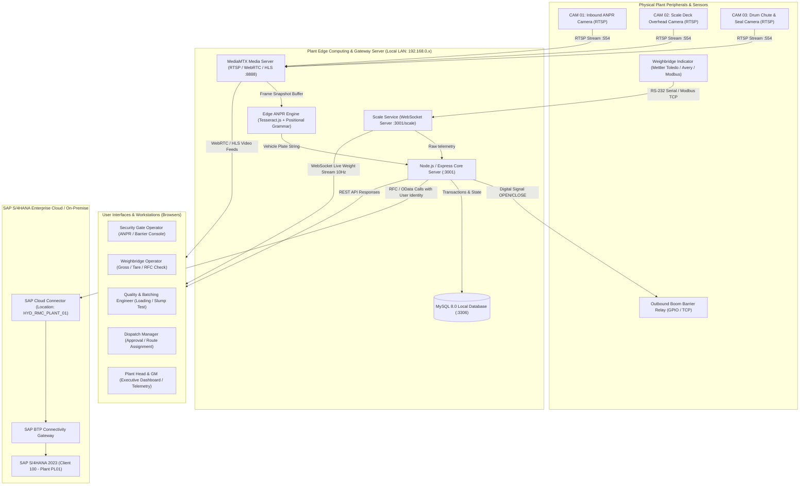
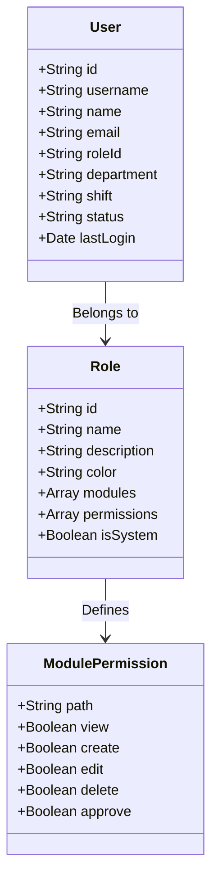

# Aparna RMC Gate-to-Exit Enterprise Operations System
## Architecture & System Design Specification

---

### Document Information
- **Project Title:** Aparna RMC Gate-to-Exit Intelligent Operations & SAP ERP Integration Platform
- **Version:** 2.4.0 (Enterprise Edition)
- **Target Deployment:** Aparna Ready Mix Concrete Plant (Plant PL01 - Shamshabad & Satellite Units)
- **Document Status:** Authoritative System Design & Engineering Architecture
- **Date:** October 2026

---

## 1. Executive Summary & Purpose

The **Aparna RMC Gate-to-Exit System** is a mission-critical, industrial-grade software platform designed to automate, monitor, and audit the end-to-end lifecycle of Ready Mix Concrete (RMC) plant operations. 

Modern RMC production requires sub-second synchronization between physical plant hardware (inbound/outbound weighbridges, optical ANPR cameras, batching plant mixers, boom barrier interlocks) and enterprise ERP systems (**SAP S/4HANA 2023**). Every cubic meter of concrete produced has a strict delivery window (typically under 90 to 120 minutes before initial setting). Weight discrepancies, unrecorded material receipts, unauthorized vehicle entry/exit, or delayed SAP Goods Issues cause severe commercial loss, quality failures, and audit non-compliance.

### Core Objectives:
1. **Automated Gate & Weighbridge Ingestion:** Sub-second vehicle identification using dual-engine Edge ANPR (Automatic Number Plate Recognition) with Indian RTO grammar validation and real-time weighbridge indicator streaming over WebSockets (RS-232 / TCP / Modbus).
2. **Bi-Directional SAP S/4HANA RFC & BAPI Sync:** Complete audit trail with operator identification stamped into every Remote Function Call for Inbound Purchase Order Goods Receipts (`BAPI_PO_GETDETAIL1`, `BAPI_GOODSMVT_CREATE` - Mvt 101/501), Outbound Delivery Post Goods Issue (`BAPI_OUTB_DELIVERY_CONFIRM_DEC` - Mvt 601), and Invoicing (`BAPI_BILLINGDOC_CREATEMULTIPLE`).
3. **Transit Mixer Lifecycle & Batch Dispatch:** Tracking transit mixer tare weight, batch volume ($m^3$), slump test certifications, tamper-evident drum seal verification, and automated gate pass generation.
4. **Physical Security & Barrier Interlock:** Hardware-level gating where outbound boom barriers are physically and logically interlocked—lifting **only** upon valid gross weight capture within $\pm 1.5\%$ design tolerance and successful SAP PGI confirmation.
5. **Real-time Telemetry & Edge Streaming:** Zero-latency RTSP-to-WebRTC/HLS camera proxying via MediaMTX, sub-100ms scale telemetry, and central plant head dashboard monitoring.

---

## 2. System Architecture (C4 Model)



---

## 3. Technology Stack Breakdown

| Layer | Technology | Version | Purpose & Architecture Role |
| :--- | :--- | :--- | :--- |
| **Frontend Framework** | React + Vite + TypeScript | React 18.3, Vite 5.4, TS 5.5 | Type-safe, single-page application with lightning-fast Hot Module Replacement (HMR). |
| **Styling & Design System** | Tailwind CSS + shadcn/ui + Radix UI | Tailwind 3.4, Lucide React | Modern dark/light operational UI alongside authentic SAP GUI Classic (`#dfcbaf` / `#1e2a38` / Tahoma) theme for SAP consoles. |
| **State & Data Fetching** | TanStack React Query + React Context | Query v5.62, Context API | Server-state caching, automatic background refetching, and global `AuthContext` with role-based permission evaluation. |
| **Backend Runtime** | Node.js (ES Modules) + Express.js | Node 20+, Express 4.21 | Asynchronous, non-blocking REST API server handling hardware streams, database transactions, and SAP connector dispatch. |
| **Relational Database** | MySQL (InnoDB Engine) | MySQL 8.0 / MariaDB 10.5+ | ACID-compliant storage for 39 tables, JSON columns for evidence/telemetry, and foreign key referential integrity. |
| **WebSocket Engine** | `ws` (Node.js WebSocket Server) | ws 8.18 | Low-overhead, zero-latency streaming of live weighbridge readings at 10 Hz directly to browser consoles. |
| **Media & Video Server** | MediaMTX (formerly rtsp-simple-server) | v1.5+ Native Binary | High-performance RTSP-to-HLS/WebRTC streaming proxy converting industrial IP camera streams into browser-playable video. |
| **Edge Optical OCR Engine** | Tesseract.js + Custom Normalizer | Tesseract 5.1 | Client & Edge node license plate recognition calibrated with Indian RTO grammar (State codes, district numbers, series, 4-digit sequence). |
| **SAP Connector** | Custom S/4HANA RFC & OData Adapter | NetWeaver / RFC Simulation | Stateful SAP communication supporting connection pooling, CSRF token handling, and multi-tier user identity audit stamps. |

---

## 4. Physical Plant & Network Deployment Topology

The system operates across a segregated industrial local area network (LAN) inside the plant premises, partitioned to isolate high-bandwidth RTSP camera traffic from time-critical weighbridge telemetry and ERP communications.

```
                             PLANT INDUSTRIAL LAN (192.168.0.0/24)
  ═════════════════════════════════════════════════════════════════════════════════════════
         │                               │                                │
  [GATE 01 - INBOUND]            [WEIGHBRIDGE PIT]              [GATE 02 - OUTBOUND]
  • CAM 01 (192.168.0.101)       • CAM 02 (192.168.0.103)       • CAM 01 Exit (192.168.0.102)
    Inbound ANPR Front             Platform Overhead Deck         High-Speed ANPR Front
  • Traffic Light Relay          • Mettler Toledo 8142          • CAM 03 Chute (192.168.0.104)
    (Green/Red Signal)             Indicator (192.168.0.150)      Drum Tamper Seal Inspector
  • Operator Tablet              • Dual Display Remote          • Exit Weighbridge Scale
    (Handheld ANPR Scanner)        Scoreboard Display             Indicator (192.168.0.151)
                                                                • Barrier Arm 01 Controller
                                                                  (192.168.0.160 - Relay GPIO)
         │                               │                                │
  ═════════════════════════════════════════════════════════════════════════════════════════
                                         │
                             [EDGE SERVER RACK - IT ROOM]
                             • IP: 192.168.0.200
                             • Core Gateway & DB (Ports 3001, 3306)
                             • MediaMTX Streaming Server (Ports 8554, 8888, 8889)
                             • SAP Cloud Connector Gateway Client
                                         │
                             [SAP BTP SECURE TUNNEL / MPLS]
                                         │
                             [CORPORATE SAP S/4HANA DATACENTER]
                             • System: PRD_S4H (Client 100)
                             • RFC Gateway: tcp://sap-s4h:3300
                             • OData HTTPS: https://sap-s4h:44300
```

---

## 5. Hardware & Peripheral Integration Architecture

### 5.1 Weighbridge Indicator Protocol Handling (`scale-service.js`)
The platform supports multi-vendor scale indicators via RS-232 serial ports (`COM1`-`COM8` on Windows, `/dev/ttyUSB0` on Linux) and Modbus TCP/IP.
- **Supported Indicator Models:**
  1. *Mettler Toledo 8142 / JagXtreme:* Continuous string format: `<STX><Status><Gross 6-digit><Tare 6-digit><CR>`.
  2. *Avery Weigh-Tronix E1205:* SMA standard protocol.
  3. *Digitronics 2000:* Binary-coded decimal packet structure.
  4. *Modbus TCP:* Direct reading of 32-bit floating point registers containing Gross, Tare, and Motion flags.
- **Physics-Based Dynamic Simulation Engine:**
  When hardware indicators are in commissioning or test mode, the scale service executes a real-time differential equation simulating vehicle axle boarding, suspension settling oscillation, platform damping, and sensor noise (filter threshold $\pm 10$ kg, sample history window of 10 frames).

### 5.2 IP Cameras & Video Streaming Architecture (`camera-stream-service.js`)
- Standard IP surveillance cameras transmit raw H.264/H.265 video over RTSP on port 554.
- Since web browsers cannot natively decode RTSP streams, the built-in `MediaMTX` proxy ingests RTSP from all plant cameras and simultaneously transmuxes the video into:
  1. **Low-Latency HLS (HTTP Live Streaming):** Served on port 8888 (`http://localhost:8888/{stream_name}/index.m3u8`).
  2. **WebRTC:** Sub-200ms ultra-low latency interactive streaming on port 8889.
  3. **Canvas Animation Fallbacks:** High-fidelity procedural SVG/Canvas simulated video streams with live ticking timecodes, bounding reticles, and optical scan lines when cameras are disconnected.

### 5.3 Optical ANPR & Edge License Plate Recognition (`edge-anpr.js`)
- Inbound and outbound cameras capture vehicle registration plates in harsh industrial conditions (dust, wet concrete splashes, night glare).
- **Dual Engine Pipeline:**
  1. *Local Edge OCR (Tesseract.js):* Ingests camera snapshots, applies thresholding and IR contrast equalization, restricts characters to `[A-Z0-9 -]`, and executes **Indian RTO positional grammar validation**:
     $$\text{Pattern: } \underbrace{\text{[A-Z]\{2\}}}_{\text{State (TS, AP, KA)}} \quad \underbrace{\text{[0-9]\{1,2\}}}_{\text{District RTO}} \quad \underbrace{\text{[A-Z]\{1,3\}}}_{\text{Series}} \quad \underbrace{\text{[0-9]\{4\}}}_{\text{Number}}$$
  2. *Positional Character Confusion Correction:* Automatically resolves typical optical misreads (e.g., in digits position, `O` $\to$ `0`, `I` $\to$ `1`, `Z` $\to$ `2`, `B` $\to$ `8`, `S` $\to$ `5`).
  3. *Cloud AI Fallback:* Optional forwarding to PlateRecognizer API for low-confidence reads ($< 85\%$).

### 5.4 Outbound Boom Barrier Interlock
- Hardware interlock module connects via TCP Socket or digital relay contact to the boom barrier motor.
- **Safety Rule Matrix:** The barrier controller strictly rejects manual raise requests unless:
  - Valid SAP Outbound Delivery exists and is selected.
  - Scale gross weight is captured and marked `stable`.
  - Transit mixer net concrete weight variance is within design tolerance ($\le \pm 1.5\%$).
  - Drum security seal is inspected and marked intact.
  - SAP PGI document number is successfully generated via RFC.

---

## 6. Security, Authentication & Role-Based Access Control (RBAC)

The system enforces granular Role-Based Access Control configured across 3 tiers:



### Pre-Configured Enterprise Roles
1. `plant_admin` (Plant Head / General Manager): Full access to all 22 operational, commercial, fleet, and configuration screens.
2. `weighbridge_operator`: Access to Weighbridge, Gate Monitor, Loading Console, and Device Diagnostics. **Restricted** from fleet trip creation, customer billing, and role configuration.
3. `quality_engineer`: Access to Loading Console, Dispatch Approval, Slump test entry, and Incident logging.
4. `dispatch_supervisor`: Access to Dispatch Approvals, Route assignments, and Exit Verification.
5. `billing_accountant`: Access to Customer Invoicing, Payments, SAP VF01 Billing Sync, and Financial Reports.
6. `fleet_manager`: Access to Vehicles, Drivers, Fuel Logs, and Maintenance Scheduling.

---

## 7. Telemetry & Data Integrity Architecture

1. **Transactional Integrity:** All weight capture operations generate immutable `weigh_slips` and `weighbridge_sessions` records.
2. **Audit Trail Logging:** Every user action (login, manual weight override, dispatch approval, SAP sync attempt, plate correction) writes to the `audit_logs` table with client IP, timestamp, user ID, module name, and payload diff.
3. **Resilient Asynchronous Sync Queue (`sap_sync_queue`):** In the event of SAP NetWeaver connectivity interruption or plant internet outage, transactions are queued locally with exponential backoff retries (maximum 5 attempts) and detailed error diagnostics.

