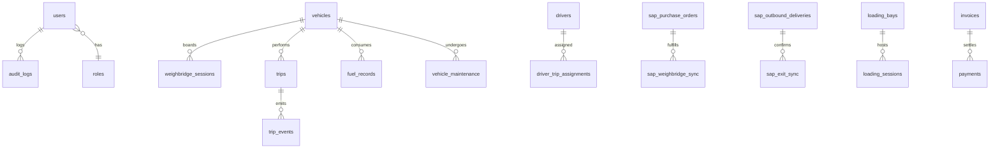

# Aparna RMC Gate-to-Exit Enterprise Operations System
## Engineering Pack & API Technical Reference

---

### Document Information
- **Document Status:** Authoritative Engineering Pack & API Contract Reference
- **Version:** 2.4.0 (Enterprise Edition)
- **Scope:** Complete REST Endpoints, SAP RFC/BAPI Signatures, Hardware Protocols, and Database Schema
- **Date:** October 2026

---

## 1. Backend Architecture & Routing Structure

The backend application is structured as a modular Node.js ES Modules application rooted at `/server`.

```
server/
├── index.js                     # Server entrypoint, middleware, camera/ANPR/scale init
├── db.js                        # MySQL connection pooling & transaction helper
├── scale-service.js             # Weighbridge Serial, TCP & WebSocket streaming engine
├── camera-stream-service.js     # MediaMTX manager, TCP prober & RTSP proxy
├── anpr-processor.js            # Dual-engine ANPR orchestrator
├── edge-anpr.js                 # Tesseract OCR & Indian RTO grammar normalization
├── sap-connector.js             # SAP S/4HANA Enterprise RFC & BAPI connector
├── ftp-service.js               # Camera snapshot ingestion from FTP drop directories
├── migrations/                  # SQL DDL schemas and migration runners
└── routes/                      # 20 Express modular router files
    ├── auth.js                  # Authentication & session verification
    ├── users.js                 # User management & profile CRUD
    ├── roles.js                 # RBAC role definitions & permissions
    ├── weighbridge.js           # Scale sessions, weigh slips, sync queries
    ├── scale.js                 # Scale configuration & manual weight triggers
    ├── sap.js                   # SAP RFC & BAPI endpoints (Core RFC Gateway)
    ├── loading.js               # Batching plant bays & loading sessions
    ├── dispatch.js              # Dispatch approvals & QC dockets
    ├── trips.js                 # Live fleet trips, waypoints & GPS events
    ├── exitVerification.js      # Outbound exit verifications & barrier logic
    ├── vehicles.js              # Vehicle inventory & document compliance
    ├── drivers.js               # Driver registry & license verification
    ├── fuel.js                  # Fuel dispensing records & mileage metrics
    ├── maintenance.js           # Vehicle maintenance scheduling & parts
    ├── billing.js               # Customer invoices & payment processing
    ├── inventory.js             # Raw material stores & stock movements
    ├── incidents.js             # Incident ticketing & anomaly escalation
    ├── reports.js               # Operational & financial reporting
    ├── audit.js                 # Immutable audit trail queries
    └── ftp.js                   # FTP camera snapshot monitoring
```

---

## 2. Complete REST API Reference

### 2.1 SAP S/4HANA RFC Gateway Router (`/api/sap`)

#### `POST /api/sap/rfc/check-user`
- **Purpose:** Verifies operator credentials and authorizations against SAP NetWeaver authorization objects via `Z_RFC_CHECK_USER_AUTH`.
- **Request Body:**
```json
{
  "userData": {
    "userId": "usr_002",
    "username": "gowri",
    "operatorName": "Gowri K"
  },
  "authContext": {
    "transactionCode": "MIGO",
    "movementType": "101",
    "plantCode": "PL01"
  }
}
```
- **Response (200 OK):**
```json
{
  "success": true,
  "rfcName": "Z_RFC_CHECK_USER_AUTH",
  "authorized": true,
  "authorizationProfile": "Z_SAP_WB_OPERATOR",
  "allowedMovementTypes": ["101", "501", "502", "601", "641"],
  "sapAuthObjects": {
    "M_MATE_WRK": "PL01",
    "M_MSEG_BWA": "101,501,601",
    "F_BKPF_BUK": "1000"
  },
  "latencyMs": 14,
  "timestamp": "2026-10-28T21:45:00.000Z"
}
```

#### `POST /api/sap/rfc/check-po`
- **Purpose:** Direct PO balance & tolerance check using `BAPI_PO_GETDETAIL1`.
- **Request Body:**
```json
{
  "poNumber": "4500128490",
  "userData": {
    "userId": "usr_002",
    "username": "gowri",
    "operatorName": "Gowri K"
  }
}
```
- **Response (200 OK):**
```json
{
  "success": true,
  "rfcName": "BAPI_PO_GETDETAIL1",
  "poNumber": "4500128490",
  "vendorCode": "VEND-10023",
  "vendorName": "Ultratech Cement Limited",
  "materialCode": "MAT-CEMENT-OPC53",
  "materialName": "OPC 53 Grade Cement",
  "orderedQty": 100.00,
  "receivedQty": 77.07,
  "pendingQty": 22.93,
  "unit": "MT",
  "tolerances": {
    "overDeliveryTolerancePct": 5.0,
    "underDeliveryTolerancePct": 5.0
  },
  "latencyMs": 19
}
```

#### `POST /api/sap/rfc/check-vehicle`
- **Purpose:** Matches an optically scanned vehicle plate against active SAP Purchase Orders or Deliveries via `Z_RFC_CHECK_VEHICLE`.
- **Request Body:**
```json
{
  "vehicleNo": "TS07UA1289",
  "direction": "inbound",
  "userData": {
    "userId": "usr_002",
    "username": "gowri",
    "operatorName": "Gowri K"
  }
}
```
- **Response (200 OK):**
```json
{
  "success": true,
  "rfcName": "Z_RFC_CHECK_VEHICLE",
  "vehicleNo": "TS07UA1289",
  "direction": "inbound",
  "matchFound": true,
  "matchedPo": {
    "poNumber": "4500128490",
    "vendorName": "Ultratech Cement Limited",
    "materialName": "OPC 53 Grade Cement",
    "pendingQty": 22.93
  },
  "latencyMs": 16
}
```

#### `POST /api/sap/rfc/consume-po`
- **Purpose:** Posts Goods Receipt against Purchase Order in SAP via `BAPI_GOODSMVT_CREATE`.
- **Request Body:**
```json
{
  "poNumber": "4500128490",
  "vehicleRegNo": "TS07UA1289",
  "grossWeight": 42500,
  "tareWeight": 18000,
  "netWeight": 24500,
  "challanNo": "CH-ULTRATECH-9941",
  "challanWeight": 24500,
  "plantCode": "PL01",
  "storageLocation": "SILO-01",
  "userData": {
    "userId": "usr_002",
    "username": "gowri",
    "operatorName": "Gowri K"
  }
}
```
- **Response (200 OK):**
```json
{
  "success": true,
  "rfcName": "BAPI_GOODSMVT_CREATE",
  "sapDocNumber": "5000182490",
  "movementType": "101",
  "consumedQty": 24.50,
  "remainingPoBalance": 0.00,
  "operatorId": "usr_002",
  "operatorName": "Gowri K",
  "bapiReturn": [
    {
      "type": "S",
      "id": "M7",
      "number": "060",
      "message": "Material document 5000182490 posted."
    }
  ],
  "latencyMs": 24
}
```

#### `POST /api/sap/rfc/check-delivery`
- **Purpose:** Verifies outbound delivery readiness for PGI via `BAPI_OUTB_DELIVERY_CONFIRM_DEC`.
- **Request Body:**
```json
{
  "deliveryNumber": "80012940",
  "userData": {
    "userId": "usr_002",
    "username": "gowri",
    "operatorName": "Gowri K"
  }
}
```

#### `POST /api/sap/rfc/consume-delivery`
- **Purpose:** Posts Goods Issue (PGI Movement 601), issues outward gate pass, and triggers boom barrier clearance.
- **Request Body:**
```json
{
  "deliveryNumber": "80012940",
  "salesOrder": "SO-3001882",
  "vehicleRegNo": "TS07UA9944",
  "grossWeight": 30220,
  "tareWeight": 13420,
  "netWeight": 16800,
  "batchVolumeM3": 7.00,
  "sealNumber": "SL-88491",
  "userData": {
    "userId": "usr_002",
    "username": "gowri",
    "operatorName": "Gowri K"
  }
}
```
- **Response (200 OK):**
```json
{
  "success": true,
  "rfcName": "BAPI_OUTB_DELIVERY_CONFIRM_DEC",
  "sapPgiDocNumber": "4900465864",
  "gatePassNumber": "OGP-2026-17054",
  "movementType": "601",
  "barrierCommand": "OPEN",
  "operatorId": "usr_002",
  "operatorName": "Gowri K",
  "latencyMs": 28
}
```

---

### 2.2 Scale & Telemetry Router (`/api/scale`)

| Method | Endpoint | Description |
| :--- | :--- | :--- |
| `GET` | `/api/scale/status` | Current live weight reading, stability flag, indicator connection status. |
| `GET` | `/api/scale/config` | Returns indicator configuration (Baud, Port, Protocol, Thresholds). |
| `POST` | `/api/scale/config` | Updates scale communication parameters (e.g. switch between simulator and COM1). |
| `POST` | `/api/scale/zero` | Sends hardware zero command to indicator. |
| `POST` | `/api/scale/tare` | Tares scale deck with current vehicle weight. |
| `POST` | `/api/scale/simulate-weight` | Injects target weight into dynamic physics settling simulator for testing. |

---

### 2.3 Optical ANPR & Camera Router (`/api/anpr` & `/api/cameras`)

| Method | Endpoint | Description |
| :--- | :--- | :--- |
| `GET` | `/api/cameras` | List all registered camera devices and dashboard visibility flags. |
| `GET` | `/api/cameras/stream-status` | Probe MediaMTX media server and stream status. |
| `GET` | `/api/cameras/diagnostics` | Complete TCP socket probe across ports 554, 80, 8000 for all camera devices. |
| `POST` | `/api/anpr/detect` | Multipart image upload for Optical OCR plate recognition. |
| `POST` | `/api/anpr/recognize-edge` | High-accuracy Edge ANPR with Indian RTO grammar normalization. |
| `POST` | `/api/anpr/webhook/:cameraId` | Camera push webhook receiver (Hikvision, Dahua, GeoVision ANPR alerts). |

---

## 3. Hardware Peripheral Protocol Specifications

### 3.1 Weighbridge Serial RS-232 / Modbus TCP Specifications

#### Continuous ASCII Protocol (Mettler Toledo 8142 / JagXtreme standard)
- **Baud Rate:** 9600 bps
- **Data Bits:** 7 or 8 | **Parity:** None or Even | **Stop Bits:** 1
- **Packet Structure (18 bytes continuous stream):**
$$\begin{array}{|c|c|c|c|c|c|}
\hline
\text{Byte 0} & \text{Byte 1} & \text{Bytes 2–3} & \text{Bytes 4–9} & \text{Bytes 10–15} & \text{Bytes 16–17} \\
\hline
\text{STX (0x02)} & \text{Status Word A} & \text{Status B, C} & \text{Gross Wt (ASCII)} & \text{Tare Wt (ASCII)} & \text{CR LF (0x0D 0x0A)} \\
\hline
\end{array}$$

#### Modbus TCP Register Mapping
- **Port:** 502 (TCP)
- **Holding Registers:**
  - `40001` - `40002`: Gross Weight (32-bit IEEE 754 Float, High-Word First)
  - `40003` - `40004`: Tare Weight (32-bit Float)
  - `40005`: Scale Status Bitmask (`Bit 0`: Motion/Settling, `Bit 1`: Center of Zero, `Bit 2`: Overcapacity)

---

## 4. Complete Database Schema (39 MySQL Tables)

The operational database `rmc_gate_system` consists of 39 InnoDB tables:



### Table Summary Index
1. `users`: Enterprise operators, supervisors, engineers with password hash and shift details.
2. `roles`: Granular module permission matrices and color codes.
3. `vehicles`: Fleet inventory with dimensions, tare weights, and statutory expiry dates.
4. `vehicle_maintenance`: Maintenance job logs, servicing costs, and mechanic signatures.
5. `vehicle_documents`: Digitized registration, insurance, fitness, and permit certificates.
6. `drivers`: Commercial driver profiles, HTV license endorsements, and emergency contacts.
7. `driver_trip_assignments`: Driver allocation to specific customer delivery trips.
8. `weighbridge_sessions`: Live weighbridge capture sessions with operator identity.
9. `weigh_slips`: Immutable printed weighbridge weight tickets.
10. `loading_bays`: Batching plant pan mixer bays and utilization state.
11. `loading_sessions`: Active batching jobs with material dosing progress.
12. `dispatches`: Pre-trip QC approval dockets, slump tests, and seal records.
13. `trips`: Active logistics trips, delivery destinations, and target pour times.
14. `trip_events`: Milestone event log (departed plant, arrived site, discharge started).
15. `exit_verifications`: Outbound exit gate weight verification records.
16. `incidents`: Plant anomalies, weight tampering, and quality failure tickets.
17. `fuel_records`: Diesel dispensing logs, odometer entries, and mileage metrics.
18. `maintenance_tasks`: Scheduled preventative maintenance jobs.
19. `parts_inventory`: Spare parts stores for mixers, batch plants, and chassis.
20. `invoices`: Commercial customer tax invoices and payment statuses.
21. `payments`: Customer remittance records (NEFT, RTGS, Cheque).
22. `inventory_items`: Raw materials stores (Cement, GGBS, Aggregates, Sand, Admixtures).
23. `stock_movements`: Stock transaction ledgers (Goods Receipts, Batching Consumption).
24. `reorder_alerts`: Automated stock depletion alerts.
25. `audit_logs`: Immutable security audit trails for all user actions.
26. `generated_reports`: Exported PDF/Excel report metadata.
27. `camera_devices`: Hardware camera profiles and IP configurations.
28. `device_rtsp_config`: RTSP stream credentials and HLS URLs.
29. `device_network_config`: Subnet masks, gateways, and DHCP settings.
30. `anpr_config`: OCR thresholds, auto-confirm confidence levels, and modes.
31. `anpr_events`: Real-time vehicle detection events from cameras.
32. `anpr_evidence`: Snapshot image paths associated with ANPR reads.
33. `sap_connection_config`: S/4HANA connection profiles, BTP URLs, and latency logs.
34. `sap_purchase_orders`: Inbound PO cache with material lines and balances.
35. `sap_weighbridge_sync`: Log of all Inbound MIGO Goods Receipts posted to SAP.
36. `sap_outbound_deliveries`: Active SAP sales delivery orders ready for exit.
37. `sap_exit_sync`: Log of all Outbound VL02N Post Goods Issues posted to SAP.
38. `sap_billing_sync`: Log of all VF01 Billing Documents posted to SAP.
39. `sap_sync_queue`: Resilient retry queue for asynchronous ERP synchronization.

