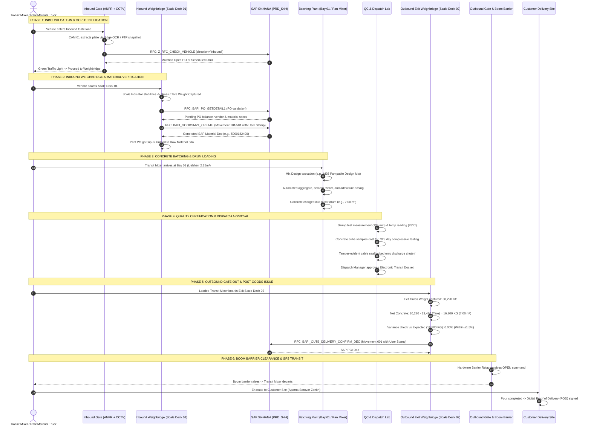

# Aparna RMC Gate-to-Exit Enterprise Operations System
## Module-Wise Functional & Technical Specifications

---

### Document Information
- **Document Status:** Authoritative Module Breakdown & Functional Blueprint
- **Version:** 2.4.0 (Enterprise Edition)
- **Scope:** All 14 Operational, Commercial, Fleet, Security, and Enterprise ERP Modules
- **Date:** October 2026

---

## 1. Master End-to-End Operational Lifecycle

The lifecycle of vehicles and materials inside an Aparna RMC plant follows a strictly controlled, linear workflow with real-time audit gates:

---

## 2. Comprehensive Module Specifications

### Module 1: Authentication, User & Role Management (RBAC)
- **Primary Routes:** `/login`, `/users`, `/roles`
- **Core Files:** `src/pages/Login.tsx`, `src/pages/UserManagement.tsx`, `src/pages/RoleManagement.tsx`, `src/contexts/AuthContext.tsx`, `server/routes/auth.js`, `server/routes/users.js`, `server/routes/roles.js`.
- **Database Tables:** `users`, `roles`.
- **Functional Description:**
  - Secure credential-based login supporting session persistence in `localStorage` (`rmc_user`, `rmc_token`).
  - Strict password hashing using bcrypt.
  - Granular RBAC allowing assignment of pre-configured roles (`plant_admin`, `weighbridge_operator`, `quality_engineer`, `dispatch_supervisor`, `billing_accountant`, `fleet_manager`) or custom roles with fine-grained view/create/edit/delete/approve flags per route.
  - Real-time user metadata extraction stamped into all SAP RFC transactions (`userId`, `username`, `operatorName`, `roleName`, `department`, `shift`).

---

### Module 2: Inbound Gate-In & Gate Monitor
- **Primary Routes:** `/gate-monitor`
- **Core Files:** `src/pages/GateMonitor.tsx`, `src/components/gate/GateCameraFeed.tsx`, `src/components/gate/ANPREventList.tsx`, `src/components/gate/PlateCorrectionDialog.tsx`, `server/routes/ftp.js`, `server/anpr-processor.js`, `server/edge-anpr.js`.
- **Database Tables:** `anpr_events`, `anpr_evidence`, `anpr_config`, `camera_devices`.
- **Functional Description:**
  - Real-time multi-camera dashboard rendering live HLS streams from Gate 01 and Gate 02.
  - Optical OCR processing of incoming vehicles with immediate plate recognition, confidence score evaluation ($0.0 - 1.0$), and vehicle type classification (Transit Mixer, Raw Material Tipper, Bulk Cement Tanker).
  - Background FTP polling service monitoring automated snapshots pushed by industrial cameras (e.g., GeoVision, Hikvision ANPR).
  - Operator plate manual correction interface with audit trail logging when plate dirt or obstruction degrades optical confidence below $85\%$.

---

### Module 3: Third-Party Weighbridge Integration: Dual-Stage Gate In & Gate Out (SAP S/4HANA MIGO/PGI)
- **Primary Routes:** `/weighbridge`
- **Core Files:** 
  - [`src/pages/Weighbridge.tsx`](file:///d:/Projects/AntiGravity/Aparna_RMC_App/rmc-gate-to-exit-main/src/pages/Weighbridge.tsx)
  - [`src/components/weighbridge/SapGateToWeighbridgeScreen.tsx`](file:///d:/Projects/AntiGravity/Aparna_RMC_App/rmc-gate-to-exit-main/src/components/weighbridge/SapGateToWeighbridgeScreen.tsx) (Classic SAP ERP Workbench Launchpad)
  - [`src/components/weighbridge/SapInboundGateInScreen.tsx`](file:///d:/Projects/AntiGravity/Aparna_RMC_App/rmc-gate-to-exit-main/src/components/weighbridge/SapInboundGateInScreen.tsx) (Dual-Stage Gate In & Gate Out Terminal /nZWB_GATEIN & /nZWB_GATEOUT)
  - [`src/components/weighbridge/ActiveInPlantTicketsDrawer.tsx`](file:///d:/Projects/AntiGravity/Aparna_RMC_App/rmc-gate-to-exit-main/src/components/weighbridge/ActiveInPlantTicketsDrawer.tsx) (Slide-over panel of in-plant vehicles)
  - [`src/components/weighbridge/SapWeighbridgeSlipModal.tsx`](file:///d:/Projects/AntiGravity/Aparna_RMC_App/rmc-gate-to-exit-main/src/components/weighbridge/SapWeighbridgeSlipModal.tsx) (Official printable Gate Pass & Weighbridge Slip)
  - [`src/components/weighbridge/WeightDisplay.tsx`](file:///d:/Projects/AntiGravity/Aparna_RMC_App/rmc-gate-to-exit-main/src/components/weighbridge/WeightDisplay.tsx)
  - [`src/components/weighbridge/WeighSlip.tsx`](file:///d:/Projects/AntiGravity/Aparna_RMC_App/rmc-gate-to-exit-main/src/components/weighbridge/WeighSlip.tsx)
  - [`server/sap-connector.js`](file:///d:/Projects/AntiGravity/Aparna_RMC_App/rmc-gate-to-exit-main/server/sap-connector.js), [`server/routes/sap.js`](file:///d:/Projects/AntiGravity/Aparna_RMC_App/rmc-gate-to-exit-main/server/routes/sap.js), [`server/scale-service.js`](file:///d:/Projects/AntiGravity/Aparna_RMC_App/rmc-gate-to-exit-main/server/scale-service.js).
- **Database Tables:** `weighbridge_sessions`, `weigh_slips`, `sap_purchase_orders`, `sap_weighbridge_sync`, `inventory_items`.
- **Functional Description:**
  - Zero-latency live weight streaming via WebSocket (`ws://localhost:3001/scale`) at 10 Hz with indicator stability detection.
  - **Mandatory 2-Stage Weighment Across 3 Scenarios:**
    1. *Scenario 1: With PO (Inbound Material Receipt):*
       - Gate In: Loaded vehicle arrives. Scale captures **Gross Weight**. PO, vendor, and material details fetched from SAP. Operator inputs vehicle number, transporter, challan number, challan weight, challan date. Save generates unique Ticket/Token (`TK-YYYYMMDD-XXXX`) in stage `'GATE_IN'` and prints Gate Pass Token.
       - Gate Out: Vehicle returns empty after unloading into silo. Operator enters ticket number or selects from active in-plant list. Scale captures **Tare Weight**. System computes $\text{Net} = \text{Gross} - \text{Tare}$ and challan variance. Save posts SAP MIGO Movement 101 Goods Receipt, updates PO open balance, marks stage `'COMPLETED'`, and prints official Weighbridge Slip.
    2. *Scenario 2: Without PO (Spot / Non-PO Raw Material Receipt):*
       - Gate In: Loaded quarry truck arrives. Scale captures **Gross Weight**. Plant details fetched from SAP. Operator enters material, vendor, vehicle, transporter, challan details. Save generates unique Ticket Number and prints Gate Pass.
       - Gate Out: Vehicle returns empty after discharging into stockpile. Scale captures **Tare Weight**. System computes $\text{Net} = \text{Gross} - \text{Tare}$. Save posts SAP MIGO Movement 501 Spot Receipt, marks stage `'COMPLETED'`, and prints Weighbridge Slip.
    3. *Scenario 3: Others (Sales / Outward Material Movement):*
       - Gate In: Vehicle arrives **empty** to load scrap/materials. Scale captures initial **Tare Weight**. Operator enters vehicle, material, customer, and destination site. Save generates unique Ticket Number.
       - Gate Out: Vehicle returns **loaded**. Scale captures **Gross Weight**. System calculates $\text{Net} = \text{Gross} - \text{Tare}$. Save posts SAP Movement 601 Post Goods Issue (PGI), marks stage `'COMPLETED'`, and prints Weighbridge Sales Slip.
  - **Active In-Plant Surveillance:** Live badge and drawer tracking all vehicles currently inside the plant that have completed Gate In and are awaiting Gate Out.
  - **Full Documentation & Architectural Blueprint:** Detailed in [`docs/modules/03_INBOUND_WEIGHBRIDGE_MIGO.md`](file:///d:/Projects/AntiGravity/Aparna_RMC_App/rmc-gate-to-exit-main/docs/modules/03_INBOUND_WEIGHBRIDGE_MIGO.md).

---

### Module 4: Concrete Batching Plant & Loading Console
- **Primary Routes:** `/loading`
- **Core Files:** `src/pages/LoadingConsole.tsx`, `src/components/loading/BayCard.tsx`, `src/components/loading/MixDesignSelector.tsx`, `src/components/loading/LoadingProgressDialog.tsx`, `server/routes/loading.js`.
- **Database Tables:** `loading_bays`, `loading_sessions`, `inventory_items`.
- **Functional Description:**
  - Real-time monitoring of batching plant bays (e.g., Bay 01 Liebherr 2.25 $m^3$ Twin-Shaft Mixer, Bay 02 Planetary Mixer).
  - Mix design selection across standard grades (M20, M25, M30, M35, M40, M50 Pumpable Design Mixes).
  - Multi-material batching progress visualization tracking precise target vs actual weights for:
    - OPC 53 Grade Cement ($kg$)
    - Fly Ash / Micro Silica ($kg$)
    - 20mm & 10mm Crushed Granite Coarse Aggregate ($kg$)
    - River Sand / M-Sand ($kg$)
    - Water & Polycarboxylate Ether (PCE) Chemical Admixture ($kg$)
  - Automatic deduction of batched ingredients from raw material stores in `inventory_items`.

---

### Module 5: Dispatch Approval & Quality Control (QC)
- **Primary Routes:** `/dispatch`
- **Core Files:** `src/pages/DispatchApproval.tsx`, `src/components/dispatch/ApprovalCard.tsx`, `src/components/dispatch/DispatchDetailsDialog.tsx`, `src/components/dispatch/RouteMapAssignment.tsx`, `server/routes/dispatch.js`.
- **Database Tables:** `dispatches`, `trips`.
- **Functional Description:**
  - Multi-point QC verification before transit mixer leaves batching bay:
    - Slump Cone Test Measurement (e.g., 120-140 mm for pumping concrete).
    - Fresh Concrete Temperature ($25^\circ\text{C} - 32^\circ\text{C}$).
    - Water-Cement Ratio ($W/C \le 0.42$).
    - Compressive Strength Test Cube Sampling (3 cubes for 7-day, 3 cubes for 28-day testing).
    - Tamper-Evident Security Seal Numbering on discharge chute.
  - Route planning and driver confirmation, outputting the signed digital dispatch docket and scheduling outbound transit.

---

### Module 6: Fleet Management
- **Primary Routes:** `/vehicles`
- **Core Files:** `src/pages/VehicleManagement.tsx`, `src/components/vehicle/VehicleCard.tsx`, `src/components/vehicle/VehicleFormDialog.tsx`, `src/components/vehicle/DocumentExpiryAlert.tsx`, `server/routes/vehicles.js`.
- **Database Tables:** `vehicles`, `vehicle_documents`, `vehicle_maintenance`.
- **Functional Description:**
  - Comprehensive asset tracking for all plant vehicles (Transit Mixers 6$m^3$/7$m^3$/8$m^3$/10$m^3$, Raw Material Tippers, Cement Tankers, Stationary Boom Pumps).
  - Vehicle tare weight baseline history.
  - Statutory compliance tracking with automated countdown alerts for:
    - National Heavy Transport Permit Expiry
    - Commercial Vehicle Insurance Policy Expiry
    - State RTO Fitness Certificate (FC) Expiry
    - Pollution Under Control (PUC) Expiry

---

### Module 7: Driver & Fuel Management
- **Primary Routes:** `/drivers`, `/fuel`
- **Core Files:** `src/pages/DriverManagement.tsx`, `src/pages/FuelManagement.tsx`, `src/components/driver/DriverCard.tsx`, `src/components/driver/DriverFormDialog.tsx`, `server/routes/drivers.js`, `server/routes/fuel.js`.
- **Database Tables:** `drivers`, `driver_trip_assignments`, `fuel_records`.
- **Functional Description:**
  - Driver records including Commercial Heavy Transport (HTV) driving license numbers, license category endorsements, RTO expiry dates, and emergency contacts.
  - Trip assignment history and driver safety performance ratings ($1.0 - 5.0$).
  - Plant diesel dispensing log tracking fuel quantity (Litres), total cost, dispensing meter reading, vehicle odometer reading, and calculating trip-by-trip fuel efficiency ($km / L$).

---

### Module 8: Live Trip Management & Real-Time Logistics Tracking
- **Primary Routes:** `/trips`, `/trip-tracking`, `/trip-analytics`
- **Core Files:** `src/pages/TripManagement.tsx`, `src/pages/TripTracking.tsx`, `src/pages/TripAnalytics.tsx`, `src/components/trip/TripCard.tsx`, `src/components/trip/LiveTrackingMap.tsx`, `server/routes/trips.js`.
- **Database Tables:** `trips`, `trip_events`.
- **Functional Description:**
  - Interactive Leaflet / Mapbox live satellite tracking showing active transit mixer locations, speed ($km/h$), and heading.
  - Critical Time-to-Site Monitoring: Countdown timer tracking maximum allowable transit time (maximum 90 minutes from batching completion to discharge start before concrete slump loss and setting occurs).
  - Geofence event triggers automatically detecting:
    - `GEOFENCE_EXIT_PLANT`: Departed plant gate.
    - `GEOFENCE_ENTER_CUSTOMER`: Arrived at customer pouring location.
    - `DRUM_ROTATION_MONITOR`: Telemetry monitoring drum rotation direction (mixing en route vs discharge on site).

---

### Module 9: Outbound Exit Verification & Boom Barrier Control
- **Primary Routes:** `/exit-verification`
- **Core Files:** 
  - `src/pages/ExitVerification.tsx`
  - `src/components/exit/SapGateToExitScreen.tsx` (SAP Outbound Workbench)
  - `src/components/exit/SapOutboundGateOutScreen.tsx` (SAP Transaction VL02N / ZEXIT_GATEOUT)
  - `src/components/exit/WeightComparison.tsx`
  - `src/components/exit/ExitVerificationSummary.tsx`
  - `server/routes/exitVerification.js`.
- **Database Tables:** `exit_verifications`, `sap_outbound_deliveries`, `sap_exit_sync`.
- **Functional Description:**
  - The final physical security gate before vehicle leaves the facility premises.
  - **Three-Camera Real-Time Optical Surveillance:**
    - `CAM 01`: High-speed front ANPR scanning license plate.
    - `CAM 02`: Scale deck overhead camera verifying full axle boarding.
    - `CAM 03`: Chute camera verifying tamper seal integrity and locked swivel pin.
  - **Net Weight & Tolerance Engine:**
    $$\text{Net Weight (KG)} = \text{Exit Gross Weight} - \text{Mixer Tare Weight}$$
    $$\text{Variance \%} = \frac{\text{Net Weight} - \text{Expected Batch Weight}}{\text{Expected Batch Weight}} \times 100$$
    $$\text{Tolerance Rule: } |\text{Variance \%}| \le 1.5\% \implies \text{APPROVED PASS}$$
  - **RFC BAPI_OUTB_DELIVERY_CONFIRM_DEC Execution:** Calls SAP to post Goods Issue (Movement 601), generates Outward Gate Pass (`OGP-2026-xxxxx`), stamps operator identity, and triggers physical boom barrier relay to `OPEN`.

---

### Module 10: SAP S/4HANA Enterprise RFC & BAPI Connector
- **Primary Component:** `src/components/sap/SapConnectionManagerModal.tsx`
- **Core Backend Service:** `server/sap-connector.js`, `server/routes/sap.js`.
- **Database Tables:** `sap_connection_config`, `sap_billing_sync`, `sap_sync_queue`.
- **Functional Description:**
  - Enterprise connection manager supporting 3 connection modes:
    1. `odata_cloud_connector`: SAP BTP Cloud Connector via secure TLS tunnel.
    2. `rfc_netweaver`: Classic TCP RFC NetWeaver protocol (Port $3300 + \text{sysnr}$).
    3. `simulation`: High-fidelity offline simulation with realistic network jitter ($15 - 35$ ms).
  - Real-time handshake diagnostics testing port reachability, CSRF token negotiation, and ping latency.
  - **Interactive Live RFC Tester & BAPI Console Tab:** Built directly into the modal to test:
    - `Z_RFC_CHECK_USER_AUTH`
    - `BAPI_PO_GETDETAIL1`
    - `Z_RFC_CHECK_VEHICLE`
    - `BAPI_GOODSMVT_CREATE`
    - `BAPI_OUTB_DELIVERY_CONFIRM_DEC`
  - Protocol telemetry logging and raw JSON payload terminal viewing.

---

### Module 11: Incident Management & Escalation
- **Primary Routes:** `/incidents`
- **Core Files:** `src/pages/IncidentManagement.tsx`, `src/components/incident/IncidentCard.tsx`, `src/components/incident/IncidentFormDialog.tsx`, `server/routes/incidents.js`.
- **Database Tables:** `incidents`.
- **Functional Description:**
  - Lifecycle tracking (`reported`, `investigating`, `resolved`, `closed`) for anomalies:
    - Weight variance exceeding $\pm 1.5\%$ tolerance limit.
    - Broken or missing drum tamper seal.
    - Slump test failure ($< 100$ mm or $> 180$ mm).
    - Unscheduled transit mixer route deviation.
    - Delivery time exceeding 120-minute concrete hydration limit.
  - Severity classification (`critical`, `high`, `medium`, `low`) with incident photographic evidence attachment.

---

### Module 12: Customer Portal & Commercial Invoicing
- **Primary Routes:** `/customer-portal`, `/billing`
- **Core Files:** `src/pages/CustomerPortal.tsx`, `src/pages/Billing.tsx`, `src/components/billing/InvoiceFormDialog.tsx`, `server/routes/billing.js`.
- **Database Tables:** `invoices`, `payments`, `sap_billing_sync`.
- **Functional Description:**
  - Generation of GST-compliant tax invoices and delivery challans for Aparna Constructions, L&T, My Home, and Prestige projects.
  - Electronic Proof of Delivery (e-POD) viewer displaying customer site receipt timestamps, unloaded concrete volume ($m^3$), and receiver signature.
  - SAP Billing Document Sync executing `BAPI_BILLINGDOC_CREATEMULTIPLE` to post Billing Document (VF01/VF02 Type F2) and Financial Accounting Document (FI 1000xxxxxx).

---

### Module 13: Raw Materials & Stores Inventory Management
- **Primary Routes:** `/inventory`
- **Core Files:** `src/pages/InventoryManagement.tsx`, `src/components/inventory/ItemCard.tsx`, `src/components/inventory/StockMovementDialog.tsx`, `server/routes/inventory.js`.
- **Database Tables:** `inventory_items`, `stock_movements`, `reorder_alerts`.
- **Functional Description:**
  - Real-time stock level tracking for critical raw materials:
    - Cement Silos 01 to 04 (OPC 53 & PPC in Metric Tons).
    - Ground Granulated Blast-furnace Slag (GGBS Silo).
    - Coarse Aggregate Stockpiles (20mm & 10mm crushed granite).
    - Fine Aggregate (M-Sand & River Sand).
    - Admixture Storage Tanks (Plasticizer & Retarder).
  - Automated reorder level warnings and reconciliation between inbound weighbridge receipts and batching plant consumption.

---

### Module 14: Hardware Device Configuration & Network Diagnostics
- **Primary Routes:** `/device-config`
- **Core Files:** `src/pages/DeviceConfig.tsx`, `src/components/device/RTSPConfigPanel.tsx`, `src/components/device/NetworkConfigPanel.tsx`, `src/components/device/ANPRConfigPanel.tsx`, `server/camera-stream-service.js`.
- **Database Tables:** `camera_devices`, `device_rtsp_config`, `device_network_config`, `anpr_config`.
- **Functional Description:**
  - Network discovery and configuration for all plant peripheral hardware.
  - Live TCP socket probing testing camera reachability on ports 554 (RTSP), 80 (HTTP), 8000 (Hikvision SDK), and 3300 (SAP RFC).
  - Stream path configuration and HLS proxy URL management (`mediamtx.yml` synchronization).

