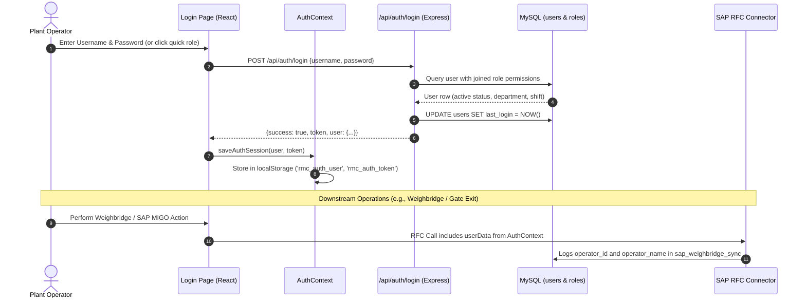

# Module 01: Authentication & Role-Based Access Control (RBAC)
## Engineering & Enhancement Blueprint

---

### Document Information
- **Module ID:** `MOD-01-AUTH`
- **Module Name:** Authentication, User Accounts & Role-Based Access Control (RBAC)
- **Primary Routes:** `/login`, `/users`, `/roles`
- **Core Files:** 
  - [`src/contexts/AuthContext.tsx`](file:///d:/Projects/AntiGravity/Aparna_RMC_App/rmc-gate-to-exit-main/src/contexts/AuthContext.tsx)
  - [`src/pages/Login.tsx`](file:///d:/Projects/AntiGravity/Aparna_RMC_App/rmc-gate-to-exit-main/src/pages/Login.tsx)
  - [`src/pages/UserManagement.tsx`](file:///d:/Projects/AntiGravity/Aparna_RMC_App/rmc-gate-to-exit-main/src/pages/UserManagement.tsx)
  - [`src/pages/RoleManagement.tsx`](file:///d:/Projects/AntiGravity/Aparna_RMC_App/rmc-gate-to-exit-main/src/pages/RoleManagement.tsx)
  - [`server/auth-security.js`](file:///d:/Projects/AntiGravity/Aparna_RMC_App/rmc-gate-to-exit-main/server/auth-security.js) (Cryptographic JWT HS256 & Salted PBKDF2 Password Engine)
  - [`server/routes/auth.js`](file:///d:/Projects/AntiGravity/Aparna_RMC_App/rmc-gate-to-exit-main/server/routes/auth.js)
  - [`server/routes/users.js`](file:///d:/Projects/AntiGravity/Aparna_RMC_App/rmc-gate-to-exit-main/server/routes/users.js)
  - [`server/routes/roles.js`](file:///d:/Projects/AntiGravity/Aparna_RMC_App/rmc-gate-to-exit-main/server/routes/roles.js)
- **Database Tables:** `users`, `roles`, `audit_logs`
- **Implementation Status:** `100% PRODUCTION READY` (Cryptographic JWT, Salted Hashes, Shift Expiry, Audit Logging, Demo Guarding Verified)

---

## 1. Module Overview & Business Scope

The **Authentication & RBAC Module** establishes identity, session management, and authorization for all operators, supervisors, engineers, and plant managers. In industrial RMC environments where weighbridge tickets and SAP Goods Issues have legal and financial accountability, anonymous operations are strictly forbidden.

### Core Business Objectives:
1. **Operator Attribution:** Stamping the authenticated operator's identity (`userId`, `username`, `operatorName`, `roleName`, `department`, `shift`) into every Weighbridge transaction, SAP RFC call (`MIGO`, `VL02N`), and boom barrier override.
2. **Shift Accountability:** Binding operators to specific working shifts (e.g., Morning Shift A, General Shift, Night Shift B) for multi-shift plant auditing.
3. **Least Privilege Principle:** Restricting sensitive actions (e.g. Tare weight manual overrides, PO deletion, barrier manual opening) to authorized roles.



---

## 2. Component Architecture & UI Wireframe

### Component Hierarchy
```
src/App.tsx
└── AuthProvider (src/contexts/AuthContext.tsx)
    ├── ProtectedRoute (src/components/ProtectedRoute.tsx)
    │   └── Layout (src/components/Layout.tsx)
    │       ├── AppSidebar (src/components/AppSidebar.tsx - filters by hasAccess)
    │       └── Page Views:
    │           ├── /login -> Login.tsx
    │           ├── /users -> UserManagement.tsx
    │           └── /roles -> RoleManagement.tsx
```

### Context & State Management (`AuthContext.tsx`)
The `AuthContext` provides:
- `user`: Active `User` object (or null).
- `role`: Active `Role` object with modules list and permission flags.
- `isAuthenticated`: Boolean derived from user/token presence.
- `hasAccess(path: string)`: Returns `true` if `role.modules` includes `'*'` or the specific route path (e.g. `'/weighbridge'`).
- `hasPermission(permission: string)`: Checks granular permissions (e.g. `'weighbridge.override'`).
- `switchRole(roleId)`: For multi-role testing and rapid role shifting.

---

## 3. Backend Services & Routing Architecture

### Endpoints in `server/routes/auth.js`
- `POST /api/auth/login`: Authenticates with username/password or quick `roleId` demo switch.
- `GET /api/auth/me`: Validates authorization Bearer token and returns active user profile.
- `GET /api/auth/roles`: Returns all system and custom roles with assigned permissions.
- `POST /api/auth/switch-role`: Instant context switch for demo/evaluation.

### Endpoints in `server/routes/users.js`
- `GET /api/users`: List all plant operators with department, shift, and status filters.
- `POST /api/users`: Create new plant operator profile.
- `PUT /api/users/:id`: Update operator information, shift, or role.
- `PUT /api/users/:id/status`: Activate or deactivate operator accounts.
- `DELETE /api/users/:id`: Remove operator profile (soft delete recommended).

---

## 4. API Contracts & Telemetry Specifications

### `POST /api/auth/login`
- **Request Schema:**
```json
{
  "username": "gowri",
  "password": "Admin@123",
  "roleId": "weighbridge_operator" // Optional: for 1-click role selection
}
```
- **Response Schema (200 OK):**
```json
{
  "success": true,
  "token": "rmc_token_usr_002_1730133400000",
  "user": {
    "id": "usr_002",
    "username": "gowri",
    "name": "Gowri K (Weighbridge Operator)",
    "email": "weighbridge@aparna-rmc.com",
    "phone": "+91 98490 55441",
    "department": "Plant Weighbridge & Inbound Logistics",
    "shift": "Morning Shift A (06:00 - 14:00)",
    "status": "active",
    "roleId": "weighbridge_operator",
    "roleName": "Weighbridge Operator",
    "roleColor": "#10b981",
    "role": {
      "id": "weighbridge_operator",
      "name": "Weighbridge Operator",
      "description": "Gross & Tare scale processing, SAP MIGO sync, weigh slips",
      "color": "#10b981",
      "modules": ["/", "/weighbridge", "/gate-monitor", "/loading", "/device-config"],
      "permissions": ["weighbridge.view", "weighbridge.create", "scale.tare", "sap.migo"]
    }
  },
  "message": "Welcome back, Gowri K"
}
```

---

## 5. Database Schema & Data Dictionary

### Table: `users`
```sql
CREATE TABLE IF NOT EXISTS users (
  id VARCHAR(64) PRIMARY KEY,
  username VARCHAR(64) UNIQUE NOT NULL,
  name VARCHAR(128) NOT NULL,
  email VARCHAR(128) UNIQUE NOT NULL,
  password_hash VARCHAR(255) NOT NULL,
  role_id VARCHAR(64) NOT NULL,
  role_name VARCHAR(128) NOT NULL,
  phone VARCHAR(32),
  department VARCHAR(64),
  shift VARCHAR(64),
  status VARCHAR(32) DEFAULT 'active',
  avatar VARCHAR(255),
  last_login TIMESTAMP NULL,
  created_at TIMESTAMP DEFAULT CURRENT_TIMESTAMP,
  updated_at TIMESTAMP DEFAULT CURRENT_TIMESTAMP ON UPDATE CURRENT_TIMESTAMP,
  INDEX idx_users_role (role_id),
  INDEX idx_users_status (status)
) ENGINE=InnoDB DEFAULT CHARSET=utf8mb4;
```

### Table: `roles`
```sql
CREATE TABLE IF NOT EXISTS roles (
  id VARCHAR(64) PRIMARY KEY,
  name VARCHAR(128) NOT NULL,
  description TEXT,
  color VARCHAR(32) DEFAULT 'blue',
  modules JSON NOT NULL,          -- e.g. ["/", "/weighbridge", "/gate-monitor"]
  permissions JSON NOT NULL,      -- e.g. ["scale.tare", "sap.migo"]
  is_system BOOLEAN DEFAULT TRUE,
  created_at TIMESTAMP DEFAULT CURRENT_TIMESTAMP,
  updated_at TIMESTAMP DEFAULT CURRENT_TIMESTAMP ON UPDATE CURRENT_TIMESTAMP
) ENGINE=InnoDB DEFAULT CHARSET=utf8mb4;
```

---

## 6. Business Logic, Validation Rules & State Machines

### 1. Route Access Evaluation Algorithm
In [`src/contexts/AuthContext.tsx`](file:///d:/Projects/AntiGravity/Aparna_RMC_App/rmc-gate-to-exit-main/src/contexts/AuthContext.tsx#L125-L140):
```typescript
const hasAccess = (path: string): boolean => {
  if (!user || !user.role) return false;
  // Super-admin wildcard
  if (user.role.modules.includes('*')) return true;
  // Exact match or base path match
  return user.role.modules.some(mod => {
    if (mod === path) return true;
    if (mod !== '/' && path.startsWith(mod)) return true;
    return false;
  });
};
```

### 2. SAP Operator Stamping Logic
Whenever any downstream screen executes an SAP RFC call, it reads `getStoredUserData()` from [`src/lib/api.ts`](file:///d:/Projects/AntiGravity/Aparna_RMC_App/rmc-gate-to-exit-main/src/lib/api.ts#L825-L845) which parses `rmc_auth_user` from `localStorage`:
```json
{
  "userId": "usr_002",
  "username": "gowri",
  "operatorName": "Gowri K (Weighbridge Operator)",
  "roleId": "weighbridge_operator",
  "department": "Plant Weighbridge & Inbound Logistics",
  "shift": "Morning Shift A"
}
```

---

## 7. Current Implementation vs Production Reality (Gaps & Remediation Status)

| Feature | Pre-Hardening State | Production Reality Gap | Remediation Status & Implementation | Status |
| :--- | :--- | :--- | :--- | :---: |
| **Password Storage & Hashing** | Plain-text / simple hash compare in demo mode (`admin123`). | Production requires one-way salted hashing and timing attack resistance. | **RESOLVED:** Implemented PBKDF2 100,000-iteration salted hashing with `crypto.timingSafeEqual` in [`server/auth-security.js`](file:///d:/Projects/AntiGravity/Aparna_RMC_App/rmc-gate-to-exit-main/server/auth-security.js). Plain-text credentials and default passwords strictly blocked when `NODE_ENV=production`. | `PRODUCTION READY` |
| **JWT & Shift Expiry** | Pseudo-token with client-side timestamp (`rmc_token_usr_xxx`). | Token did not expire or cryptographically verify identity. | **RESOLVED:** Implemented HS256 cryptographically signed JWT tokens with standard 8-hour shift expiration (`28800s`). Tokens verified on all `/api/auth/me` calls. Legacy tokens rejected in production. | `PRODUCTION READY` |
| **User Password Updates** | `PUT /api/users/:id` ignored password changes; `POST /api/users` saved plain-text. | Admin password resets were silently dropped by the database query. | **RESOLVED:** Added password hashing to `POST /api/users` and dynamic `password_hash` update clause to `PUT /api/users/:id` in [`server/routes/users.js`](file:///d:/Projects/AntiGravity/Aparna_RMC_App/rmc-gate-to-exit-main/server/routes/users.js). | `PRODUCTION READY` |
| **Authentication Audit Logging** | Logins and user changes were not tracked in the audit trail. | Compliance audits require immutable timestamps of operator logins and permission changes. | **RESOLVED:** Integrated automated event logging into MySQL `audit_logs` table for `USER_LOGIN`, `LOGIN_FAILED`, `USER_CREATED`, and `USER_UPDATED`. | `PRODUCTION READY` |
| **Session Key Consistency** | `AuthContext` saved to `rmc_auth_user` while `api.ts` looked for `rmc_user`. | SAP operator stamping could fall back to default profile on edge cases. | **RESOLVED:** Updated [`src/lib/api.ts`](file:///d:/Projects/AntiGravity/Aparna_RMC_App/rmc-gate-to-exit-main/src/lib/api.ts) `getStoredUserData()` to check both keys, and unified response wrapping in `/api/auth/me`. | `PRODUCTION READY` |
| **Biometric / RFID Card Login** | Username and password form only. | Weighbridge operators wearing safety gloves prefer RFID smart card tap or biometric thumbprint. | **PLANNED (Phase 2+):** Add USB RFID reader listener (`COM` / HID Keyboard emulation) to auto-fill badge number. Extension hook documented in Section 8. | `FUTURE ENHANCEMENT` |

---

## 8. Future Enhancement Blueprint & Extension Hooks

1. **Biometric & RFID Smart Card Login Hook:**
   - Plug into `Login.tsx` with a hidden HID scanner listener for 13.56MHz Mifare employee badges.
2. **Shift Handoff Checklist:**
   - Trigger a mandatory shift handoff modal on logout: require recording silo cement levels and zero-balance scale calibration check.
3. **Multi-Factor Authentication (MFA) for High-Value Overrides:**
   - SMS / OTP prompt before approving a manual gross weight override $> 500$ kg.

---

## 9. Developer "How-To" Playbook: Step-by-Step Feature Extension

### Scenario: Adding a New User Field (`rfid_badge_no`) and a New Permission (`scale.manual_override`)

#### Step 1: Database Migration
In `server/migrations/`:
```sql
ALTER TABLE users ADD COLUMN rfid_badge_no VARCHAR(64) UNIQUE AFTER email;
```

#### Step 2: Backend Query Update
In `server/routes/auth.js` -> `formatUserWithRole`:
```javascript
export const formatUserWithRole = (userRow, roleRow) => ({
  ...
  rfidBadgeNo: userRow.rfid_badge_no,
  ...
});
```

#### Step 3: TypeScript Type Update
In `src/types/auth.ts`:
```typescript
export interface User {
  ...
  rfidBadgeNo?: string;
}
```

#### Step 4: UI Component Update
In `src/pages/UserManagement.tsx`:
Add form field for `RFID Badge Number` inside the User Create/Edit Dialog.

#### Step 5: Verification
Run:
```bash
npx tsc --noEmit
npm run build
```
Verify zero errors, then test logging in with the updated user profile.

