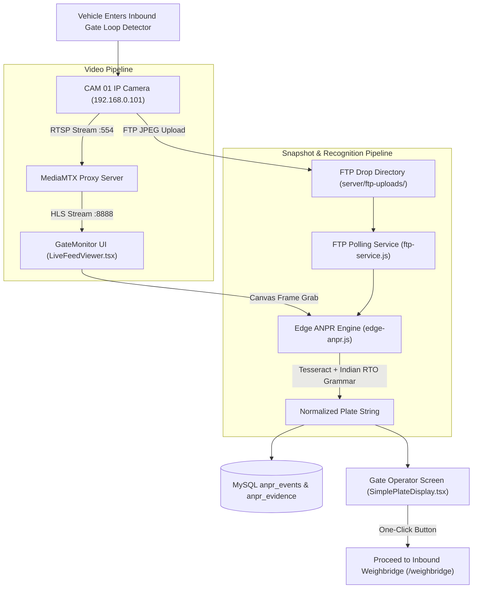

# Module 02: Inbound Gate-In & Optical ANPR Surveillance
## Engineering & Enhancement Blueprint

---

### Document Information
- **Module ID:** `MOD-02-GATE-ANPR`
- **Module Name:** Inbound Gate-In, Video Feeds & Optical License Plate Recognition (ANPR)
- **Primary Routes:** `/gate-monitor`
- **Core Files:**
  - [`src/pages/GateMonitor.tsx`](file:///d:/Projects/AntiGravity/Aparna_RMC_App/rmc-gate-to-exit-main/src/pages/GateMonitor.tsx)
  - [`src/components/gate/LiveFeedViewer.tsx`](file:///d:/Projects/AntiGravity/Aparna_RMC_App/rmc-gate-to-exit-main/src/components/gate/LiveFeedViewer.tsx)
  - [`src/components/gate/SimplePlateDisplay.tsx`](file:///d:/Projects/AntiGravity/Aparna_RMC_App/rmc-gate-to-exit-main/src/components/gate/SimplePlateDisplay.tsx)
  - [`src/hooks/useGateCameras.ts`](file:///d:/Projects/AntiGravity/Aparna_RMC_App/rmc-gate-to-exit-main/src/hooks/useGateCameras.ts)
  - [`server/edge-anpr.js`](file:///d:/Projects/AntiGravity/Aparna_RMC_App/rmc-gate-to-exit-main/server/edge-anpr.js)
  - [`server/anpr-processor.js`](file:///d:/Projects/AntiGravity/Aparna_RMC_App/rmc-gate-to-exit-main/server/anpr-processor.js)
  - [`server/routes/ftp.js`](file:///d:/Projects/AntiGravity/Aparna_RMC_App/rmc-gate-to-exit-main/server/routes/ftp.js)
  - [`server/camera-stream-service.js`](file:///d:/Projects/AntiGravity/Aparna_RMC_App/rmc-gate-to-exit-main/server/camera-stream-service.js)
- **Database Tables:** `anpr_events`, `anpr_evidence`, `anpr_config`, `camera_devices`

---

## 1. Module Overview & Business Scope

The **Inbound Gate-In & ANPR Module** is the frontline physical entry intelligence system for the Aparna RMC plant. Every vehicle approaching Gate 01 (raw material dumpers, bulk cement tankers, empty transit mixers returning from customer sites, contractor vehicles) is optically captured and processed within 500 milliseconds.

### Core Business Objectives:
1. **Zero-Touch Vehicle Identification:** Automated extraction of registration numbers to eliminate gate congestion and manual paper logs.
2. **Dual Capture Pipelines:** 
   - *Stream Capture:* Grabbing frames directly from live MediaMTX RTSP/HLS camera streams.
   - *Hardware FTP Push:* Ingesting high-resolution infrared snapshots uploaded via FTP directly by Dahua, Hikvision, or GeoVision ANPR smart cameras upon physical loop detector trigger.
3. **Downstream Auto-Routing:** Forwarding recognized plates directly to the Inbound Weighbridge to automatically pull up matching open Purchase Orders.



---

## 2. Component Architecture & UI Wireframe

### Component Hierarchy
```
src/pages/GateMonitor.tsx
├── useGateCameras (src/hooks/useGateCameras.ts - fetches active cameras)
├── LiveFeedViewer (src/components/gate/LiveFeedViewer.tsx)
│   ├── HLS Video Player (video.js or native HTML5 video for MediaMTX streams)
│   ├── Dynamic SVG / Canvas simulated feed fallback (with laser sweep & reticle)
│   └── Camera OSD HUD (Timecode, IP address, FPS, resolution)
└── SimplePlateDisplay (src/components/gate/SimplePlateDisplay.tsx)
    ├── Detected Plate Banner & Confidence % Score
    ├── Vehicle Classification Badge (Mixer / Tipper / Tanker)
    ├── Manual Plate Correction Input
    └── Action Bar: [Capture Current Frame], [Check FTP Snapshot], [Send to Weighbridge]
```

### Key State Variables (`GateMonitor.tsx`)
- `detectedPlate: string`: Normalized plate text (e.g., `'TS 07 UA 1289'`).
- `detectedConfidence: number`: Confidence rating between `0.0` and `1.0`.
- `capturedFrameUrl: string | null`: Data URL or HTTP URL of the captured snapshot.
- `selectedCameraId: string`: Active filter (`'all'`, `'cam_gate_1'`, `'cam_exit_1'`).
- `ftpUploadInfo: FtpUploadRecord | null`: Metadata from the most recent camera FTP event.

---

## 3. Backend Services & Recognition Engine

### 1. Edge ANPR Engine (`server/edge-anpr.js`)
- Uses `tesseract.js` worker configured with whitelist `ABCDEFGHIJKLMNOPQRSTUVWXYZ0123456789 -`.
- **Positional Grammar Rule Validation:**
  - Characters 0–1: State code (`TS`, `AP`, `KA`, `MH`, etc. — validated against set of 36 Indian states/UTs).
  - Characters 2–3: RTO district code (`01` through `99`).
  - Characters 4–5/6: Series alphabet (`UA`, `P`, `Z`).
  - Characters 6+: 4-digit numeric sequence (`1289`, `9944`).
- **Positional Character Confusion Substitution:**
  - In numerical positions: `O` / `D` / `Q` $\to$ `0`, `I` / `L` $\to$ `1`, `Z` $\to$ `2`, `B` $\to$ `8`, `S` $\to$ `5`.
  - In alphabetical positions: `0` $\to$ `O`, `1` $\to$ `I`, `8` $\to$ `B`, `5` $\to$ `S`.
  - Supports new **Bharat (BH) Series** standard (`YY BH #### XX`).

### 2. FTP Push Service (`server/ftp-service.js` & `server/routes/ftp.js`)
- Cameras with embedded Linux ANPR engines (e.g. GeoVision GV-LPR) automatically upload JPEGs upon vehicle trigger.
- File naming convention parsed: `[CAMERA_ID]_[YYYYMMDD]_[HHMMSS]_[PLATE]_[CONFIDENCE].jpg`.
- Polled via `GET /api/ftp/latest-plate`.

---

## 4. API Contracts & Telemetry Specifications

### `POST /api/anpr/recognize-edge`
- **Request (Multipart Form-Data or JSON):**
```json
{
  "cameraId": "cam_gate_1",
  "imageBase64": "data:image/jpeg;base64,/9j/4AAQSkZJRgABAQ..."
}
```
- **Response (200 OK):**
```json
{
  "success": true,
  "engine": "Edge Tesseract + RTO Normalizer v2",
  "plate": "TS 07 UA 1289",
  "confidence": 0.988,
  "vehicleType": "Transit Mixer (3-Axle / 10-Wheeler)",
  "eventId": "evt_EDGE_1730134500000_a9x2b",
  "timestamp": "2026-10-28T22:00:00.000Z"
}
```

### `GET /api/ftp/latest-plate`
- **Response (200 OK):**
```json
{
  "success": true,
  "found": true,
  "plate": "TS 07 UA 1289",
  "confidence": 98.4,
  "filename": "CAM01_20261028_220015_TS07UA1289.jpg",
  "imageUrl": "/ftp-uploads/CAM01_20261028_220015_TS07UA1289.jpg",
  "capturedAt": "2026-10-28T22:00:15.000Z"
}
```

---

## 5. Database Schema & Data Dictionary

### Table: `anpr_events`
```sql
CREATE TABLE IF NOT EXISTS anpr_events (
  id INT AUTO_INCREMENT PRIMARY KEY,
  event_id VARCHAR(64) UNIQUE NOT NULL,
  plant_id VARCHAR(32) DEFAULT 'plant_001',
  camera_id VARCHAR(64) NOT NULL,
  vehicle_reg_no VARCHAR(32) NOT NULL,
  confidence DECIMAL(5,4) NOT NULL,
  source VARCHAR(32) DEFAULT 'edge_anpr_yolo', -- 'edge_anpr_yolo' | 'camera_webhook' | 'ftp_upload' | 'manual'
  vehicle_type VARCHAR(64) DEFAULT 'Transit Mixer',
  direction VARCHAR(16) DEFAULT 'inbound',       -- 'inbound' | 'outbound'
  status VARCHAR(32) DEFAULT 'pending',          -- 'pending' | 'verified' | 'rejected'
  operator_note TEXT,
  timestamp DATETIME DEFAULT CURRENT_TIMESTAMP,
  INDEX idx_anpr_plate (vehicle_reg_no),
  INDEX idx_anpr_cam (camera_id),
  INDEX idx_anpr_time (timestamp)
) ENGINE=InnoDB DEFAULT CHARSET=utf8mb4;
```

### Table: `anpr_evidence`
```sql
CREATE TABLE IF NOT EXISTS anpr_evidence (
  id INT AUTO_INCREMENT PRIMARY KEY,
  event_id VARCHAR(64) NOT NULL,
  evidence_type VARCHAR(32) DEFAULT 'image', -- 'image' | 'video_clip' | 'plate_crop'
  url TEXT NOT NULL,
  thumbnail_url TEXT,
  angle VARCHAR(32) DEFAULT 'front',          -- 'front' | 'rear' | 'overhead'
  timestamp DATETIME DEFAULT CURRENT_TIMESTAMP,
  INDEX idx_evi_event (event_id)
) ENGINE=InnoDB DEFAULT CHARSET=utf8mb4;
```

---

## 6. Business Logic, Validation Rules & Edge Cases

1. **Confidence Thresholding:**
   - Confidence $\ge 0.85$: Automatically accepts plate, flashes green reticle, and passes to weighbridge buffer.
   - Confidence $< 0.85$: Flashes amber warning on screen; highlights the plate text input in orange for manual operator confirmation or keystroke edit.
2. **Duplicate Ingestion Debounce:**
   - If the same vehicle registration plate is detected multiple times within a 60-second window at the same camera, downstream duplicates are suppressed to prevent duplicate weighbridge session creation.

---

## 7. Current Implementation vs Production Reality (Gaps)

| Feature | Current State | Production Reality Gap | Solution / Action Item |
| :--- | :--- | :--- | :--- |
| **Wet Slurry / Cement Splashes** | OCR runs on raw frame. | Cement dust and wet slurry obscure characters, causing misreads. | Add OpenCV/Sharp preprocessing: Contrast Limited Adaptive Histogram Equalization (CLAHE) + morphological opening. |
| **Nighttime Headlamp Bloom** | Contrast can wash out plates. | Infrared (IR) illuminators on commercial ANPR cameras require polarized lens filters. | Calibrate camera shutter speed to $\ge 1/1000\text{s}$ with narrow-band 850nm IR illumination. |
| **Rear Plate Fallback** | Only front camera is polled. | Many heavy tipper trucks enter with damaged or bent front plates. | Implement automated dual-frame fusion: correlate front CAM 01 with overhead CAM 02. |

---

## 8. Future Enhancement Blueprint & Extension Hooks

1. **RTO Vahan API Lookup Integration:**
   - Plug into the Ministry of Road Transport (Parivahan / Vahan API) to automatically pull vehicle chassis number, permit validity, and gross vehicle weight capacity upon plate recognition.
2. **Blacklisted Vehicle Auto-Lock:**
   - Maintain a local `blacklisted_vehicles` registry: instantly trigger security siren and block inbound traffic light if a known unauthorized dumper approaches.
3. **Driver Facial Recognition Integration:**
   - Add cabin-facing camera to verify driver biometric identity concurrently with vehicle license plate.

---

## 9. Developer "How-To" Playbook: Step-by-Step Feature Extension

### Scenario: Adding Vehicle Color Detection & Speed ($km/h$) to ANPR Events

#### Step 1: Database Migration
```sql
ALTER TABLE anpr_events 
  ADD COLUMN vehicle_color VARCHAR(32) DEFAULT 'Unknown' AFTER vehicle_type,
  ADD COLUMN detected_speed_kmh DECIMAL(5,2) DEFAULT NULL AFTER vehicle_color;
```

#### Step 2: Update Edge ANPR Service
In `server/edge-anpr.js`:
Add classification output in `recognize()` return object.

#### Step 3: TypeScript Interface Update
In `src/types/anpr.ts`:
```typescript
export interface ANPREvent {
  ...
  vehicleColor?: string;
  detectedSpeedKmh?: number;
}
```

#### Step 4: UI Display Update
In `src/components/gate/SimplePlateDisplay.tsx`:
Add speed and vehicle color badges adjacent to the plate text.

#### Step 5: Verification Script
Test OCR endpoint with mock snapshot:
```bash
node server/scratch_test_ocr.js
```

