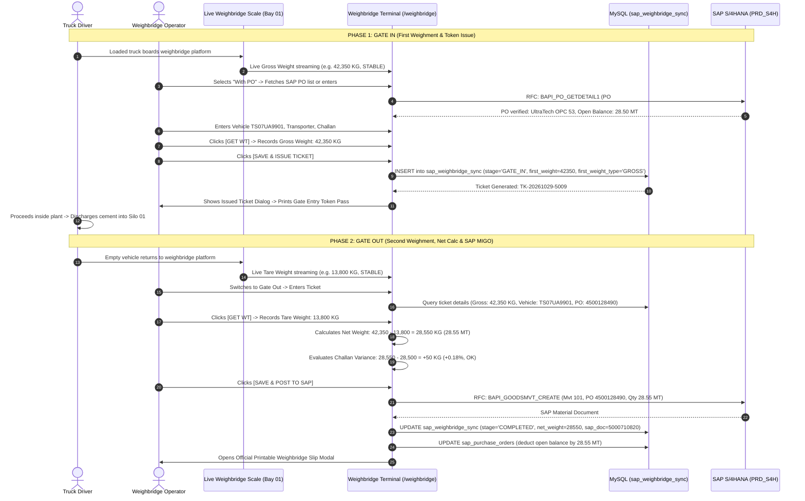

# Module 03: Inbound Weighbridge & SAP PO Goods Receipt (MIGO)
## Engineering, Functional Specification & Gate In / Gate Out Integration Blueprint

---

### Document Information
- **Module ID:** `MOD-03-INBOUND-WB`
- **Module Name:** Third-Party Weighbridge Integration: Dual-Stage Gate In / Gate Out Process across With PO, Without PO, and Outward Sales Scenarios
- **Primary Routes:** `/weighbridge`
- **Core Files:**
  - [`src/pages/Weighbridge.tsx`](file:///d:/Projects/AntiGravity/Aparna_RMC_App/rmc-gate-to-exit-main/src/pages/Weighbridge.tsx)
  - [`src/components/weighbridge/SapGateToWeighbridgeScreen.tsx`](file:///d:/Projects/AntiGravity/Aparna_RMC_App/rmc-gate-to-exit-main/src/components/weighbridge/SapGateToWeighbridgeScreen.tsx)
  - [`src/components/weighbridge/SapInboundGateInScreen.tsx`](file:///d:/Projects/AntiGravity/Aparna_RMC_App/rmc-gate-to-exit-main/src/components/weighbridge/SapInboundGateInScreen.tsx)
  - [`src/components/weighbridge/ActiveInPlantTicketsDrawer.tsx`](file:///d:/Projects/AntiGravity/Aparna_RMC_App/rmc-gate-to-exit-main/src/components/weighbridge/ActiveInPlantTicketsDrawer.tsx)
  - [`src/components/weighbridge/SapWeighbridgeSlipModal.tsx`](file:///d:/Projects/AntiGravity/Aparna_RMC_App/rmc-gate-to-exit-main/src/components/weighbridge/SapWeighbridgeSlipModal.tsx)
  - [`src/components/weighbridge/WeightDisplay.tsx`](file:///d:/Projects/AntiGravity/Aparna_RMC_App/rmc-gate-to-exit-main/src/components/weighbridge/WeightDisplay.tsx)
  - [`src/components/weighbridge/WeighSlip.tsx`](file:///d:/Projects/AntiGravity/Aparna_RMC_App/rmc-gate-to-exit-main/src/components/weighbridge/WeighSlip.tsx)
  - [`server/sap-connector.js`](file:///d:/Projects/AntiGravity/Aparna_RMC_App/rmc-gate-to-exit-main/server/sap-connector.js)
  - [`server/routes/sap.js`](file:///d:/Projects/AntiGravity/Aparna_RMC_App/rmc-gate-to-exit-main/server/routes/sap.js)
  - [`server/scale-service.js`](file:///d:/Projects/AntiGravity/Aparna_RMC_App/rmc-gate-to-exit-main/server/scale-service.js)
  - [`server/migrations/run_weighbridge_gate_in_out_migration.js`](file:///d:/Projects/AntiGravity/Aparna_RMC_App/rmc-gate-to-exit-main/server/migrations/run_weighbridge_gate_in_out_migration.js)
- **Database Tables:** `weighbridge_sessions`, `weigh_slips`, `sap_purchase_orders`, `sap_weighbridge_sync`, `inventory_items`

---

## 1. Executive Summary & Functional Scope

The Aparna RMC Third-Party Weighbridge integration connects the industrial pitless weighbridge platform (60 MT electronic scale) with **SAP S/4HANA (PRD_S4H Client 100)**. 

To ensure complete custody audit and eliminate single-pass weighment fraud, the system executes a **mandatory two-stage transaction lifecycle (Gate In followed by Gate Out)** across three operational scenarios:

1. **Scenario 1: With PO (Inbound Material Receipt against Purchase Order)**
   - Bulk cement tankers (UltraTech OPC 53, JSW Slag), fly ash, and silica fume delivered under an active corporate Purchase Order.
2. **Scenario 2: Without PO (Spot / Non-PO Raw Material Receipt)**
   - Local quarry blue metal stone aggregates (10mm, 20mm), river sand, and emergency deliveries arriving with supplier delivery challan.
3. **Scenario 3: Others (Sales / Outward Material Movement)**
   - Vehicle initially enters the plant **empty** and exits **loaded** (e.g., structural steel scrap sale, transit mixer empty tare certification, sludge/sediment disposal).

---

## 2. Weight Polarity Inversion & Net Weight Invariance

The physical nature of the vehicle's state on arrival and departure differs between inbound material receipts and outward dispatches:

| Parameter | Scenario 1: With PO (Inbound) | Scenario 2: Without PO (Inbound) | Scenario 3: Others (Sales / Outward) |
| :--- | :--- | :--- | :--- |
| **Initial Vehicle State** | **LOADED** with raw material | **LOADED** with raw material | **EMPTY** entering to collect goods |
| **Gate In Weighment** | **Gross Weight** captured | **Gross Weight** captured | **Tare Weight** captured |
| **Intermediate Action** | Unloading at Silo / Aggregate Bin | Unloading at Quarry Stockpile | Loading steel scrap / goods in yard |
| **Return Vehicle State**| **EMPTY** returning to scale | **EMPTY** returning to scale | **LOADED** returning to scale |
| **Gate Out Weighment**| **Tare Weight** captured | **Tare Weight** captured | **Gross Weight** captured |
| **Net Weight Formula** | $$\text{Net} = \text{Gross} - \text{Tare}$$ | $$\text{Net} = \text{Gross} - \text{Tare}$$ | $$\text{Net} = \text{Gross} - \text{Tare}$$ |
| **SAP Posting** | Movement 101 (`MIGO` Goods Receipt) | Movement 501 (`MIGO` Spot Receipt) | Movement 601 (`VL02N` Post Goods Issue) |

> [!IMPORTANT]
> In all scenarios, the mathematical formula for billable/inventory quantity is invariant:
> $$\text{Net Weight} = \text{Gross Weight} - \text{Tare Weight}$$
> The software automatically adjusts weight assignment targets so the operator never has to manually invert weights.

---

## 3. End-to-End Operational Lifecycle & Sequence Diagrams

### 3.1 Scenario 1: Inbound Material Receipt With PO



---

### 3.2 Scenario 2: Inbound Material Receipt Without PO

- **Gate In:**
  1. Operator selects **Without PO** (Movement Type 501).
  2. Plant details fetched automatically from SAP (`PL01` Shamshabad).
  3. Loaded truck arrives at weighbridge. Scale automatically records **Gross Weight**.
  4. Operator enters: Material (e.g., 20mm Blue Metal Aggregate), Vendor Name (e.g., Sri Krishna Stone Works), Vehicle Reg No, Transporter, Challan No, Challan Weight, and Challan Date.
  5. Clicks **Save**: Records transaction in `sap_weighbridge_sync` (stage `'GATE_IN'`) and generates unique ticket number (e.g., `TK-20261029-2504`).
  6. Gate pass token is printed. Vehicle enters plant to discharge aggregate into stockpile.
- **Gate Out:**
  1. Empty truck returns to weighbridge after unloading.
  2. Operator enters or selects `TK-20261029-2504`. Gate In details retrieved automatically.
  3. Scale records **Tare Weight** (e.g., 12,500 KG).
  4. Net Weight calculated:
     $$\text{Net Weight} = 36,800 - 12,500 = 24,300 \text{ KG } (24.30 \text{ MT})$$
  5. Clicks **Save & Post to SAP**: Backend posts Movement 501 Goods Receipt, updates record to `'COMPLETED'`, and launches printable weighbridge slip.

---

### 3.3 Scenario 3: Others (Sales / Outward Material Movement)

- **Gate In:**
  1. Operator selects **Others** (Movement Type 601 / Outward Dispatch).
  2. Plant details fetched from SAP (`PL01`).
  3. **Empty vehicle arrives at plant** to load scrap/goods. Scale automatically captures **Tare Weight** (e.g., 11,200 KG).
  4. Operator enters Vehicle Reg No, Material (e.g., Structural Steel Scrap), Transporter, Customer Name (e.g., Hitech Metal Recyclers), and Destination Site (e.g., Balanagar Yard).
  5. Clicks **Save**: Records transaction in `sap_weighbridge_sync` with `first_weight_type = 'TARE'` and issues ticket (e.g., `TK-20261029-3145`).
- **Gate Out:**
  1. Truck returns to weighbridge **fully loaded with material**.
  2. Operator enters ticket `TK-20261029-3145`. System recalls initial Tare Weight (11,200 KG).
  3. Scale captures **Gross Weight** (e.g., 23,450 KG).
  4. Net Weight calculated:
     $$\text{Net Weight} = \text{Gross Weight} - \text{Tare Weight} = 23,450 - 11,200 = 12,250 \text{ KG } (12.25 \text{ MT})$$
  5. Clicks **Save & Post to SAP**: Backend posts Post Goods Issue (PGI) Movement 601, marks stage `'COMPLETED'`, and generates the certified Weighbridge Sales Slip.

---

## 4. Database Schema Specification

Executed via [`server/migrations/run_weighbridge_gate_in_out_migration.js`](file:///d:/Projects/AntiGravity/Aparna_RMC_App/rmc-gate-to-exit-main/server/migrations/run_weighbridge_gate_in_out_migration.js):

```sql
ALTER TABLE sap_weighbridge_sync
  ADD COLUMN ticket_number VARCHAR(50) UNIQUE NULL AFTER session_id,
  ADD COLUMN scenario ENUM('WITH_PO', 'WITHOUT_PO', 'OTHERS') DEFAULT 'WITH_PO' AFTER sync_type,
  ADD COLUMN stage ENUM('GATE_IN', 'COMPLETED', 'CANCELLED') DEFAULT 'COMPLETED' AFTER status,
  ADD COLUMN first_weight DECIMAL(10,3) NULL AFTER gross_weight,
  ADD COLUMN first_weight_type ENUM('GROSS', 'TARE') DEFAULT 'GROSS' AFTER first_weight,
  ADD COLUMN second_weight DECIMAL(10,3) NULL AFTER first_weight_type,
  ADD COLUMN second_weight_type ENUM('GROSS', 'TARE') DEFAULT 'TARE' AFTER second_weight,
  ADD COLUMN gate_in_time DATETIME NULL AFTER synced_at,
  ADD COLUMN gate_out_time DATETIME NULL AFTER gate_in_time,
  ADD COLUMN gate_in_operator_id VARCHAR(50) NULL AFTER operator_id,
  ADD COLUMN gate_in_operator_name VARCHAR(100) NULL AFTER operator_name,
  ADD COLUMN gate_out_operator_id VARCHAR(50) NULL AFTER gate_in_operator_id,
  ADD COLUMN gate_out_operator_name VARCHAR(100) NULL AFTER gate_in_operator_name,
  ADD COLUMN item_no VARCHAR(10) DEFAULT '10' AFTER po_number,
  ADD COLUMN vendor_code VARCHAR(50) NULL AFTER vendor_name,
  ADD COLUMN material_code VARCHAR(50) NULL AFTER material_name,
  ADD COLUMN challan_no VARCHAR(50) NULL AFTER driver_name,
  ADD COLUMN challan_weight DECIMAL(10,3) NULL AFTER challan_no,
  ADD COLUMN challan_date VARCHAR(20) NULL AFTER challan_weight,
  ADD COLUMN transporter VARCHAR(100) NULL AFTER challan_date,
  ADD COLUMN customer_name VARCHAR(150) NULL AFTER transporter,
  ADD COLUMN destination_site VARCHAR(150) NULL AFTER customer_name,
  ADD COLUMN seal_number VARCHAR(50) NULL AFTER destination_site,
  ADD INDEX idx_wb_ticket (ticket_number),
  ADD INDEX idx_wb_stage (stage),
  ADD INDEX idx_wb_scenario (scenario);
```

---

## 5. API Endpoints & RFC Interface Contracts

### 5.1 POST `/api/sap/weighbridge/gate-in`
**Request Payload:**
```json
{
  "scenario": "with_po",
  "plant": "PL01",
  "grossWeight": 42350,
  "vehicleNumber": "TS07UA9901",
  "transporter": "Aparna Logistics Fleet",
  "poNumber": "4500128490",
  "itemNo": "10",
  "vendorCode": "VEND-10023",
  "vendorName": "UltraTech Cement Limited",
  "materialCode": "MAT-CEM-OPC53",
  "materialName": "Ordinary Portland Cement 53 Grade",
  "challanNo": "CH-2026-9901",
  "challanWeight": 28500,
  "challanDate": "29.10.2026",
  "userData": {
    "userId": "USR-003",
    "username": "ramesh.k",
    "name": "Ramesh Kulkarni"
  }
}
```

**Response (200 OK):**
```json
{
  "success": true,
  "ticketNumber": "TK-20261029-5009",
  "sessionId": "WB-SESS-032599",
  "scenario": "WITH_PO",
  "stage": "GATE_IN",
  "vehicleRegNo": "TS07UA9901",
  "firstWeight": 42350,
  "firstWeightType": "GROSS",
  "plantCode": "PL01",
  "poNumber": "4500128490",
  "vendorName": "UltraTech Cement Limited",
  "materialName": "Ordinary Portland Cement 53 Grade",
  "challanNo": "CH-2026-9901",
  "gateInTime": "2026-10-29T13:37:12.644Z",
  "operatorName": "Ramesh Kulkarni",
  "latencyMs": 45,
  "message": "Gate In saved successfully. Unique Ticket TK-20261029-5009 issued."
}
```

---

### 5.2 GET `/api/sap/weighbridge/ticket/:ticketNumber`
Retrieves Gate In details for hydrating the Gate Out terminal by Ticket Number (e.g., `TK-20261029-5009`) or vehicle registration plate (e.g., `TS07UA9901`).

---

### 5.3 GET `/api/sap/weighbridge/active-tickets`
Returns all vehicles currently inside the plant that have completed Gate In and are awaiting Gate Out:
```json
{
  "success": true,
  "count": 1,
  "tickets": [
    {
      "ticketNumber": "TK-20261029-5009",
      "sessionId": "WB-SESS-032599",
      "scenario": "WITH_PO",
      "vehicleNumber": "TS07UA9901",
      "vehicleRegNo": "TS07UA9901",
      "poNumber": "4500128490",
      "vendorName": "UltraTech Cement Limited",
      "materialName": "Ordinary Portland Cement 53 Grade",
      "firstWeight": 42350,
      "firstWeightType": "GROSS",
      "gateInTime": "2026-10-29T13:37:12.644Z",
      "gateInOperatorName": "Ramesh Kulkarni",
      "challanNo": "CH-2026-9901"
    }
  ]
}
```

---

### 5.4 POST `/api/sap/weighbridge/gate-out`
**Request Payload:**
```json
{
  "ticketNumber": "TK-20261029-5009",
  "tareWeight": 13800,
  "userData": {
    "userId": "USR-003",
    "name": "Ramesh Kulkarni"
  }
}
```

**Response (200 OK):**
```json
{
  "success": true,
  "ticketNumber": "TK-20261029-5009",
  "slipNumber": "SLIP-2026-8817",
  "status": "COMPLETED",
  "scenario": "WITH_PO",
  "vehicleRegNo": "TS07UA9901",
  "materialName": "Ordinary Portland Cement 53 Grade",
  "grossWeight": 42350,
  "tareWeight": 13800,
  "netWeight": 28550,
  "sapDocNumber": "5000710820",
  "movementType": "101",
  "gateInTime": "2026-10-29T13:37:12.000Z",
  "gateOutTime": "2026-10-29T13:37:12.696Z",
  "operatorName": "Ramesh Kulkarni",
  "latencyMs": 30,
  "message": "Gate Out completed. Net Weight: 28550 kg. SAP Document #5000710820 posted."
}
```

---

## 6. Frontend Consoles & UI Components

1. **`SapGateToWeighbridgeScreen.tsx`**:
   - Primary SAP workbench landing view.
   - Dual-mode tab toggle: `[ ➔ GATE IN (First Weighment) ]` vs `[ ➔ GATE OUT (Second Weighment & MIGO) ]`.
   - Active In-Plant Vehicles ribbon showing live count of vehicles in plant.
   - In Gate In: provides scenario selection (1. With PO, 2. Without PO, 3. Others), live platform weight indicator, and open PO list with `[ Check RFC ]` balance verification.
   - In Gate Out: quick ticket search bar and active in-plant vehicle cards with one-click `[ Process Gate Out ]` buttons.
2. **`SapInboundGateInScreen.tsx`**:
   - Full SAP GUI modal (classic menu bar, toolbar, fastpath `/nZWB_GATEIN` and `/nZWB_GATEOUT`, and tan `#dfcbaf` styling).
   - Real-time scale polling with `[ GET WT ]` button.
   - Multi-camera surveillance cards:
     - CAM 01: Front ANPR plate camera with FTP polling and Edge OCR recognition.
     - CAM 02: Platform scale bay camera with live HLS stream (`http://localhost:8888/cam2/index.m3u8`) and simulation fallback.
     - CAM 03: Driver cabin and chute inspection.
   - Gate In save triggers the **Issued Ticket Dialog** with barcode preview, print gate pass option, and direct switch to Gate Out.
3. **`ActiveInPlantTicketsDrawer.tsx`**:
   - Slide-over drawer listing all vehicles currently inside the plant awaiting Gate Out.
   - Displays plate, ticket #, scenario badge, first weight, entry time, and transporter.
   - 1-click on any ticket loads it directly into Gate Out.
4. **`SapWeighbridgeSlipModal.tsx`**:
   - Dual-purpose official printable slip component:
     - **Gate Entry Token Pass:** Issued at Gate In.
     - **Final Weighbridge Slip:** Issued at Gate Out with dual weights (Gross & Tare), Net Material Weight, SAP Document reference, Challan Variance comparison, timestamps, and operator/driver signatures.

---

## 7. Automated Test Suite & Verification Results

E2E automated test suite executed via `server/test_e2e_gate_in_out.mjs` against live MySQL database:

```
=== E2E Test Server listening on http://127.0.0.1:3099 ===

--- TEST 1: SCENARIO 1 (WITH PO) ---
Gate In (With PO) Response: 200 OK -> Ticket Issued: TK-20261029-5009 (Gross: 42,350 KG)
Active in-plant tickets count: 8 -> Found in active list: true
Gate Out (With PO) Response: 200 OK -> Tare: 13,800 KG, Net: 28,550 KG
✓ Scenario 1 PASS: Net Weight = 28550 KG (42350 - 13800), SAP Doc: 5000710820

--- TEST 2: SCENARIO 2 (WITHOUT PO) ---
Gate In (Without PO) Response: 200 OK -> Ticket Issued: TK-20261029-2504 (Gross: 36,800 KG)
Gate Out (Without PO) Response: 200 OK -> Tare: 12,500 KG, Net: 24,300 KG
✓ Scenario 2 PASS: Net Weight = 24300 KG (36800 - 12500), SAP Doc: 5000170717

--- TEST 3: SCENARIO 3 (OTHERS / OUTWARD SALES) ---
Gate In (Others) Response: 200 OK -> Ticket Issued: TK-20261029-3145 (Tare: 11,200 KG)
Gate Out (Others) Response: 200 OK -> Gross: 23,450 KG, Net: 12,250 KG
✓ Scenario 3 PASS: Net Weight = 12250 KG (23450 - 11200), SAP Doc: 4900232691

🎉 ALL 3 SAP WEIGHBRIDGE GATE-IN & GATE-OUT SCENARIOS TESTED AND FULLY VERIFIED!
```

- TypeScript check (`npx tsc --noEmit`): **Exited with code 0 (zero errors)**.
- Production build (`npm run build`): **Built successfully in 38.37s (`dist/index.html` generated)**.
