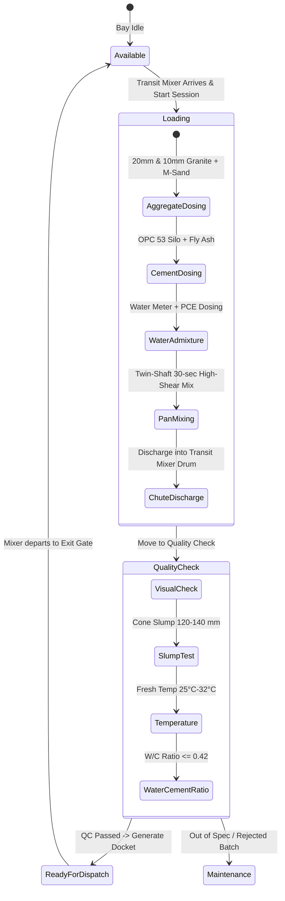

# Module 04: Concrete Batching Plant & Loading Console
## Engineering & Enhancement Blueprint

---

### Document Information
- **Module ID:** `MOD-04-BATCHING-LOADING`
- **Module Name:** Concrete Batching Plant, Bay Allocation & Mixing Console
- **Primary Routes:** `/loading`
- **Core Files:**
  - [`src/pages/LoadingConsole.tsx`](file:///d:/Projects/AntiGravity/Aparna_RMC_App/rmc-gate-to-exit-main/src/pages/LoadingConsole.tsx)
  - [`src/components/loading/BayStatusCard.tsx`](file:///d:/Projects/AntiGravity/Aparna_RMC_App/rmc-gate-to-exit-main/src/components/loading/BayStatusCard.tsx)
  - [`src/components/loading/MaterialDispenser.tsx`](file:///d:/Projects/AntiGravity/Aparna_RMC_App/rmc-gate-to-exit-main/src/components/loading/MaterialDispenser.tsx)
  - [`src/components/loading/LoadingProgress.tsx`](file:///d:/Projects/AntiGravity/Aparna_RMC_App/rmc-gate-to-exit-main/src/components/loading/LoadingProgress.tsx)
  - [`src/components/loading/QualityChecklist.tsx`](file:///d:/Projects/AntiGravity/Aparna_RMC_App/rmc-gate-to-exit-main/src/components/loading/QualityChecklist.tsx)
  - [`src/hooks/useLoadingBays.ts`](file:///d:/Projects/AntiGravity/Aparna_RMC_App/rmc-gate-to-exit-main/src/hooks/useLoadingBays.ts)
  - [`server/routes/loading.js`](file:///d:/Projects/AntiGravity/Aparna_RMC_App/rmc-gate-to-exit-main/server/routes/loading.js)
- **Database Tables:** `loading_bays`, `loading_sessions`, `inventory_items`, `stock_movements`

---

## 1. Module Overview & Business Scope

The **Concrete Batching Plant & Loading Console** oversees the high-precision mixing and charging of Ready-Mix Concrete into transit mixer drums. Aparna RMC operates automated high-capacity twin-shaft pan mixers (e.g. Liebherr 2.25 $m^3$ batch capacity, 120 $m^3/\text{hour}$ plant rating).

### Core Business Objectives:
1. **Bay Queue Scheduling:** Allocating transit mixers to available batching bays (`Bay 01`, `Bay 02`, `Bay 03`) to eliminate queue idling.
2. **Mix Design Execution:** Dynamic loading of Bureau of Indian Standards (BIS / IS 456 / IS 10262) mix formulations (M20, M25, M30, M35, M40, M50 Pumpable Design Mixes).
3. **Sequential Material Dosing:** Monitoring real-time load-cell batching of aggregates, cement, fly ash, micro-silica, water, and chemical admixtures (PCE plasticizers).
4. **Automated Inventory Depletion:** Immediately deducting dispensed quantities from the raw materials silos in `inventory_items`.



---

## 2. Component Architecture & UI Wireframe

### Component Hierarchy
```
src/pages/LoadingConsole.tsx
├── useLoadingBays (src/hooks/useLoadingBays.ts)
├── Bay Status Grid:
│   └── BayStatusCard (Bay 01, Bay 02, Bay 03)
│       ├── Mixer Status Indicator (Available / In Progress / Quality Check)
│       ├── Active Vehicle Plate & Mix Design Badge
│       └── Overall Loading Progress Bar (% Complete)
│
└── Selected Bay Inspector:
    ├── MaterialDispenser.tsx (Interactive dosing bars: Target vs Actual kg)
    ├── LoadingProgress.tsx (Step sequencer: Aggregates -> Cement -> Mixing)
    └── QualityChecklist.tsx (Slump test, slump flow, temperature, water-cement checks)
```

---

## 3. Backend Services & Batching Engine

### Endpoints in `server/routes/loading.js`
- `GET /api/loading/bays`: Returns all bays with active sessions and operator assignments.
- `POST /api/loading/start`: Initializes a new batch loading session for a vehicle and mix design.
- `POST /api/loading/dispense`: Records incremental dispensing of material from hoppers.
- `POST /api/loading/quality-check`: Saves quality verification checklist results.
- `POST /api/loading/complete`: Closes session, moves transit mixer to Dispatch Approval, and triggers inventory deduction.

---

## 4. API Contracts & Telemetry Specifications

### `POST /api/loading/start`
- **Request Body:**
```json
{
  "bayId": "bay_01",
  "vehicleRegNo": "TS07UA9944",
  "mixDesignId": "mix_m35_pumpable",
  "targetVolumeM3": 7.00,
  "operatorId": "usr_004"
}
```
- **Response (200 OK):**
```json
{
  "success": true,
  "sessionId": "load_sess_1730135000000_k9x",
  "bayId": "bay_01",
  "status": "in_progress",
  "mixDesign": {
    "grade": "M35 Design Mix",
    "slumpTarget": "125 mm",
    "materials": [
      { "material": "OPC 53 Cement", "targetKg": 2520, "actualKg": 0 },
      { "material": "Fly Ash (Class F)", "targetKg": 420, "actualKg": 0 },
      { "material": "20mm Coarse Aggregate", "targetKg": 4900, "actualKg": 0 },
      { "material": "10mm Coarse Aggregate", "targetKg": 3290, "actualKg": 0 },
      { "material": "Manufactured Sand (M-Sand)", "targetKg": 5040, "actualKg": 0 },
      { "material": "Water", "targetKg": 1190, "actualKg": 0 },
      { "material": "PCE Superplasticizer", "targetKg": 25.2, "actualKg": 0 }
    ]
  }
}
```

---

## 5. Database Schema & Data Dictionary

### Table: `loading_bays`
```sql
CREATE TABLE IF NOT EXISTS loading_bays (
  id VARCHAR(50) PRIMARY KEY,
  name VARCHAR(100) NOT NULL,
  status VARCHAR(30) DEFAULT 'available', -- 'available' | 'in_progress' | 'quality_check' | 'maintenance'
  current_session JSON,
  capacity INT DEFAULT 50,               -- Mixer capacity m3/hr
  location VARCHAR(100),
  updated_at DATETIME DEFAULT CURRENT_TIMESTAMP ON UPDATE CURRENT_TIMESTAMP
) ENGINE=InnoDB DEFAULT CHARSET=utf8mb4;
```

### Table: `loading_sessions`
```sql
CREATE TABLE IF NOT EXISTS loading_sessions (
  session_id VARCHAR(50) PRIMARY KEY,
  bay_id VARCHAR(50) NOT NULL,
  vehicle_reg_no VARCHAR(50) NOT NULL,
  mix_design_id VARCHAR(50),
  start_time DATETIME DEFAULT CURRENT_TIMESTAMP,
  end_time DATETIME,
  materials JSON,                       -- Array of target vs actual dispensed kg
  quality_checks JSON,                  -- Slump, temperature, W/C ratio
  overall_progress INT DEFAULT 0,       -- 0 to 100%
  status VARCHAR(30) DEFAULT 'in_progress', -- 'in_progress' | 'quality_check' | 'completed' | 'cancelled'
  operator_id VARCHAR(50),
  created_at DATETIME DEFAULT CURRENT_TIMESTAMP,
  INDEX idx_load_bay (bay_id),
  INDEX idx_load_veh (vehicle_reg_no)
) ENGINE=InnoDB DEFAULT CHARSET=utf8mb4;
```

---

## 6. Business Logic & Dosing Validation Rules

1. **Sequential Interlock:** Dosing must proceed in strict order: Aggregates $\to$ Cement $\to$ Water & Chemical Admixtures $\to$ High-Shear Mixing for minimum 30 seconds.
2. **Batch Dosing Accuracy Tolerance (IS 4926):**
   - Cement and Water: $\pm 1\%$ of target weight.
   - Aggregates: $\pm 2\%$ of target weight.
   - Admixtures: $\pm 3\%$ of target weight.
3. **Automated Stock Deduction:**
   Closing a loading session automatically issues `UPDATE inventory_items SET current_stock = current_stock - ? WHERE sku = ?` for each ingredient.

---

## 7. Current Implementation vs Production Reality (Gaps)

| Feature | Current State | Production Reality Gap | Solution / Action Item |
| :--- | :--- | :--- | :--- |
| **PLC SCADA Interfacing** | Software simulation with `dispenseMaterial()` helper. | Industrial batch plants use Siemens S7-1200 or Allen-Bradley PLCs controlling load cell hoppers. | Implement OPC UA / Modbus TCP client polling PLC registers for real-time hopper weights. |
| **Moisture Compensation** | Fixed sand weight target. | Rain and moisture content in sand hoppers require live moisture probe deduction. | Connect hopper moisture probes to dynamically adjust water and sand target weights in real time. |

---

## 8. Future Enhancement Blueprint & Extension Hooks

1. **Automated Mixer Drum Washout Tracker:**
   - Track transit mixer drum wash cycles after every discharge to prevent hardened concrete residue buildup.
2. **Ice Dosing Calculator for Hot Weather Concreting:**
   - Automatically calculate chilled water and flake ice requirements when ambient temperature exceeds $38^\circ\text{C}$ to maintain concrete temperature $< 32^\circ\text{C}$.

---

## 9. Developer "How-To" Playbook: Step-by-Step Feature Extension

### Scenario: Adding Flake Ice Dosing ($kg$) for Hot Weather Concrete

#### Step 1: Update Mix Design Schema
In `server/routes/loading.js`, add `Flake Ice` to material targets in mix designs.

#### Step 2: Update UI Dosing Display
In `src/components/loading/MaterialDispenser.tsx`, add an icon and blue progress bar for `Flake Ice (kg)`.

#### Step 3: Verification
Verify that ice is deducted from ice plant inventory upon session completion.

