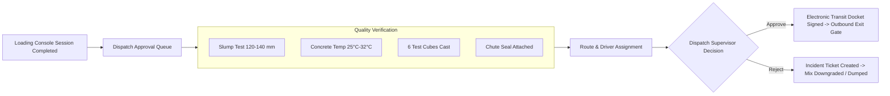

# Module 05: Dispatch Approval & Quality Control (QC)
## Engineering & Enhancement Blueprint

---

### Document Information
- **Module ID:** `MOD-05-DISPATCH-QC`
- **Module Name:** Dispatch Review, Quality Certification & Route Assignment
- **Primary Routes:** `/dispatch`
- **Core Files:**
  - [`src/pages/DispatchApproval.tsx`](file:///d:/Projects/AntiGravity/Aparna_RMC_App/rmc-gate-to-exit-main/src/pages/DispatchApproval.tsx)
  - [`src/components/dispatch/ApprovalCard.tsx`](file:///d:/Projects/AntiGravity/Aparna_RMC_App/rmc-gate-to-exit-main/src/components/dispatch/ApprovalCard.tsx)
  - [`src/components/dispatch/DispatchDetailsDialog.tsx`](file:///d:/Projects/AntiGravity/Aparna_RMC_App/rmc-gate-to-exit-main/src/components/dispatch/DispatchDetailsDialog.tsx)
  - [`src/components/dispatch/RouteAssignmentDialog.tsx`](file:///d:/Projects/AntiGravity/Aparna_RMC_App/rmc-gate-to-exit-main/src/components/dispatch/RouteAssignmentDialog.tsx)
  - [`src/hooks/useDispatchApproval.ts`](file:///d:/Projects/AntiGravity/Aparna_RMC_App/rmc-gate-to-exit-main/src/hooks/useDispatchApproval.ts)
  - [`server/routes/dispatch.js`](file:///d:/Projects/AntiGravity/Aparna_RMC_App/rmc-gate-to-exit-main/server/routes/dispatch.js)
- **Database Tables:** `dispatches`, `trips`

---

## 1. Module Overview & Business Scope

The **Dispatch Approval & QC Module** serves as the quality assurance gateway between plant production and road transit. Because Ready-Mix Concrete is a perishable chemical mixture with an irreversible hydration reaction, a batch cannot leave the batching plant without certified quality tests and planned transit routes.

### Core Business Objectives:
1. **Mandatory Quality Gates:** Verifying slump cone test results (workability), concrete temperature, and casting of standard $150\text{ mm} \times 150\text{ mm} \times 150\text{ mm}$ compressive strength test cubes.
2. **Transit Security Seals:** Registering the tamper-evident serial cable seal number locked onto the mixer chute.
3. **Route & Pouring Window Planning:** Assigning verified transit routes avoiding heavy traffic bottlenecks to guarantee arrival within the maximum 90-minute concrete SLA.
4. **Electronic Transit Docket Issuance:** Generating the official digital dispatch docket approving the mixer to proceed to the exit weighbridge.



---

## 2. Component Architecture & UI Wireframe

### Component Hierarchy
```
src/pages/DispatchApproval.tsx
├── useDispatchApproval (src/hooks/useDispatchApproval.ts)
├── Summary Metrics Cards (Pending Approvals, Approved Today, Rejected Today)
├── Tabs Filter: [Pending Approvals] | [Approved Dispatches] | [Rejected Dispatches]
└── Grid of Dispatches:
    └── ApprovalCard.tsx
        ├── Vehicle Plate, Driver & Destination Site
        ├── Concrete Grade (e.g. M35 Pumpable), Batch Volume (7.00 m³)
        ├── Quality Status Badges (Slump Pass, Temp Pass, Seal Tag)
        ├── Action Buttons: [View Details], [Assign Route], [Approve], [Reject]
        │
        ├── DispatchDetailsDialog.tsx (Full QC breakdown & documentation preview)
        └── RouteAssignmentDialog.tsx (Interactive route selector with ETA calculation)
```

---

## 3. Backend Services & Routing Architecture

### Endpoints in `server/routes/dispatch.js`
- `GET /api/dispatch`: Returns all dispatches filtered by status (`pending`, `approved`, `rejected`).
- `POST /api/dispatch/approve`: Approves dispatch, updates status to `approved`, and schedules outbound trip in `trips`.
- `POST /api/dispatch/reject`: Rejects dispatch with mandatory rejection reason and creates an anomaly incident.
- `POST /api/dispatch/assign-route`: Updates route path, estimated travel time (minutes), and assigned driver.

---

## 4. API Contracts & Telemetry Specifications

### `POST /api/dispatch/approve`
- **Request Body:**
```json
{
  "dispatchId": "disp_001",
  "approvedBy": "Suresh Reddy (QC Supervisor)",
  "notes": "Slump 130mm verified, 6 cubes cast for 7/28 day testing. Chute seal #SL-88491 intact."
}
```
- **Response (200 OK):**
```json
{
  "success": true,
  "dispatchId": "disp_001",
  "status": "approved",
  "approvedAt": "2026-10-28T22:20:00.000Z",
  "tripId": "trip_001",
  "message": "Dispatch approved. Transit mixer authorized for exit gate weighing."
}
```

---

## 5. Database Schema & Data Dictionary

### Table: `dispatches`
```sql
CREATE TABLE IF NOT EXISTS dispatches (
  id VARCHAR(50) PRIMARY KEY,
  vehicle_reg_no VARCHAR(50) NOT NULL,
  timestamp DATETIME DEFAULT CURRENT_TIMESTAMP,
  material VARCHAR(100),                -- e.g. 'M35 Design Mix'
  quantity DECIMAL(10,2),               -- Volume in m3
  unit VARCHAR(20) DEFAULT 'm³',
  customer VARCHAR(150),
  documentation JSON,                   -- Challan, invoice, slump test results
  route JSON,                           -- Destination site, coordinates, estimated minutes
  plate_images JSON,                    -- Snapshot evidence
  status VARCHAR(30) DEFAULT 'pending', -- 'pending' | 'approved' | 'rejected'
  approved_by VARCHAR(100),
  approved_at DATETIME,
  rejection_reason TEXT,
  created_at DATETIME DEFAULT CURRENT_TIMESTAMP,
  INDEX idx_disp_status (status),
  INDEX idx_disp_veh (vehicle_reg_no)
) ENGINE=InnoDB DEFAULT CHARSET=utf8mb4;
```

---

## 6. Business Logic & Quality Interlocks

1. **Slump Test Rejection Rule:**
   - Standard pumpable concrete slump must be between $100\text{ mm}$ and $160\text{ mm}$.
   - If Slump $< 100\text{ mm}$ (stiff mix, risk of choking concrete pump line) or Slump $> 180\text{ mm}$ (bleeding/segregation risk), approval is locked and requires Chief Metallurgist sign-off.
2. **Pouring Window Expiry Rule:**
   - If transit time exceeds 90 minutes, retarding admixture dosage must be certified on the docket.

---

## 7. Current Implementation vs Production Reality (Gaps)

| Feature | Current State | Production Reality Gap | Solution / Action Item |
| :--- | :--- | :--- | :--- |
| **Cube Testing Automation** | Checkbox for cubes cast. | 7-day and 28-day compression test results are currently recorded in physical lab registers. | Build Lab Testing Module allowing lab technicians to enter breaking loads ($kN$) and auto-calculate $N/mm^2$ strength. |
| **GPS Transit Time Sync** | Static route minutes. | Real-time traffic congestion on Hyderabad Outer Ring Road (ORR) affects actual transit time. | Integrate Google Maps Distance Matrix API for dynamic live ETA calculations. |

---

## 8. Future Enhancement Blueprint & Extension Hooks

1. **Concrete Compressive Strength Certificate Generator:**
   - Auto-generate certified strength test certificates after 28 days for customer submission.
2. **Automated Admixture Redosing Log:**
   - Record site redosing of superplasticizers if slump drops upon customer site arrival.

---

## 9. Developer "How-To" Playbook: Step-by-Step Feature Extension

### Scenario: Adding Concrete Temperature (°C) to Dispatch QC Form

#### Step 1: Database Migration
```sql
ALTER TABLE dispatches ADD COLUMN concrete_temp_c DECIMAL(4,1) DEFAULT 28.0 AFTER material;
```

#### Step 2: TypeScript Interface Update
In `src/types/dispatch.ts`:
```typescript
export interface PendingDispatch {
  ...
  concreteTempC?: number;
}
```

#### Step 3: UI Badge & Form Update
In `src/components/dispatch/ApprovalCard.tsx`, add a thermometer icon and temperature badge (`28.5°C [PASS]`).

