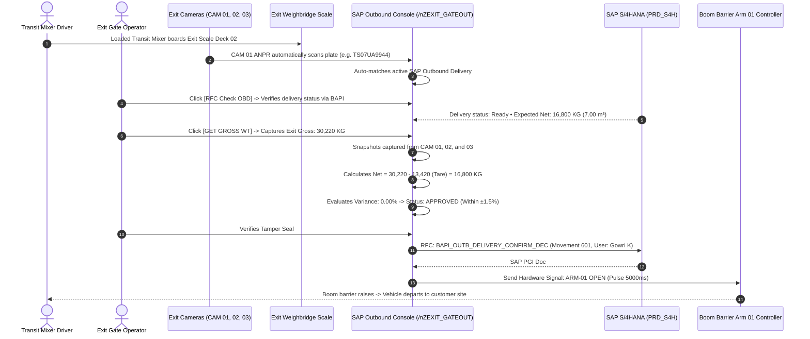

# Module 06: Outbound Exit Verification & Boom Barrier Interlock
## Engineering & Enhancement Blueprint

---

### Document Information
- **Module ID:** `MOD-06-EXIT-BARRIER`
- **Module Name:** Outbound Exit Verification, Net Weight Tolerance Check & Boom Barrier Control
- **Primary Routes:** `/exit-verification`
- **Core Files:**
  - [`src/pages/ExitVerification.tsx`](file:///d:/Projects/AntiGravity/Aparna_RMC_App/rmc-gate-to-exit-main/src/pages/ExitVerification.tsx)
  - [`src/components/exit/SapGateToExitScreen.tsx`](file:///d:/Projects/AntiGravity/Aparna_RMC_App/rmc-gate-to-exit-main/src/components/exit/SapGateToExitScreen.tsx)
  - [`src/components/exit/SapOutboundGateOutScreen.tsx`](file:///d:/Projects/AntiGravity/Aparna_RMC_App/rmc-gate-to-exit-main/src/components/exit/SapOutboundGateOutScreen.tsx)
  - [`src/components/exit/WeightComparison.tsx`](file:///d:/Projects/AntiGravity/Aparna_RMC_App/rmc-gate-to-exit-main/src/components/exit/WeightComparison.tsx)
  - [`src/components/exit/ExitVerificationSummary.tsx`](file:///d:/Projects/AntiGravity/Aparna_RMC_App/rmc-gate-to-exit-main/src/components/exit/ExitVerificationSummary.tsx)
  - [`server/routes/exitVerification.js`](file:///d:/Projects/AntiGravity/Aparna_RMC_App/rmc-gate-to-exit-main/server/routes/exitVerification.js)
  - [`server/sap-connector.js`](file:///d:/Projects/AntiGravity/Aparna_RMC_App/rmc-gate-to-exit-main/server/sap-connector.js)
- **Database Tables:** `exit_verifications`, `sap_outbound_deliveries`, `sap_exit_sync`

---

## 1. Module Overview & Business Scope

The **Outbound Exit Verification & Boom Barrier Interlock Module** is the final security checkpoint protecting the plant against unauthorized vehicle dispatch, concrete theft, incorrect batch quantities, and ERP synchronization delays.

Once a transit mixer completes batch loading, it proceeds to Exit Gate 02. The vehicle is weighed on the exit weighbridge scale to verify that the loaded concrete quantity matches the SAP Outbound Delivery (OBD) schedule within strict design density tolerances ($\pm 1.5\%$).

### Core Business Objectives:
1. **Net Concrete Tolerance Guardrails:** Prevents under-loaded concrete (customer complaints) or over-loaded concrete (structural mix imbalance and plant material shrinkage).
2. **Post Goods Issue (PGI) Movement 601:** Executes `BAPI_OUTB_DELIVERY_CONFIRM_DEC` in SAP S/4HANA with operator audit stamps.
3. **Hardware Boom Barrier Interlock:** The physical gate barrier remains locked until gross weight, drum seal, slump certificate, and SAP PGI document are verified.
4. **Three-Camera Exit Audit:** Concurrently capturing front ANPR, scale deck positioning, and discharge chute tamper seal snapshots.



---

## 2. Component Architecture & UI Wireframe

### Component Hierarchy
```
src/pages/ExitVerification.tsx
├── SapGateToExitScreen.tsx (SAP Selection Workbench)
│   ├── Mode Radios: Outbound Delivery (601) / Stock Transfer (641) / Empty Mixer (502)
│   ├── Live Scale Deck Telemetry Widget (Big digital readout in MT & KG)
│   ├── Live Camera Feeds (CAM 01 ANPR, CAM 02 Deck, CAM 03 Chute)
│   └── Active Outbound Deliveries Table (Ready Dispatches for Plant PL01)
│
└── SapOutboundGateOutScreen.tsx (SAP Transaction VL02N / ZEXIT_GATEOUT Modal)
    ├── SAP Standard Menu Bar & Operator Identity Badge (System: PRD_S4H • Operator: Gowri K)
    ├── Form Grid:
    │   ├── Outbound Delivery Number (with "RFC Check OBD" button)
    │   ├── Sales Order Ref, Customer Name, Destination Site
    │   ├── Concrete Grade (M35 Pumpable), Batch Volume (7.00 m³), Bay (BAY-01)
    │   ├── Vehicle Number (with Live ANPR OCR sync button)
    │   ├── Commercial Docs (Challan No, E-Way Bill No, Tax Invoice No)
    │   └── Security & QC (Tamper Seal Number, Seal Intact Checkbox, Chute Locked Checkbox)
    ├── Three Live Camera Canvas Previews (Simulated 3K UHD feeds with laser sweep)
    └── Weight & Tolerance Calculator Card
```

---

## 3. Backend Services & Tolerance Calculation Engine

### Tolerance & Variance Mathematical Engine
In [`src/components/exit/SapOutboundGateOutScreen.tsx`](file:///d:/Projects/AntiGravity/Aparna_RMC_App/rmc-gate-to-exit-main/src/components/exit/SapOutboundGateOutScreen.tsx#L684-L691):
$$\text{Calculated Net Weight (KG)} = \text{Gross Weight} - \text{Mixer Tare Weight}$$
$$\text{Calculated Volume } (m^3) = \frac{\text{Calculated Net Weight (KG)}}{\text{Standard Concrete Density } (2,400\text{ kg}/m^3)}$$
$$\text{Variance (KG)} = \text{Calculated Net Weight} - \text{Expected Net Weight}$$
$$\text{Variance \%} = \left(\frac{\text{Variance (KG)}}{\text{Expected Net Weight}}\right) \times 100$$
$$\text{Approval Condition: } |\text{Variance \%}| \le 1.50\%$$

### SAP RFC PGI Execution (`server/sap-connector.js`)
When `initialSyncType === 'delivery_ref'`, the endpoint `POST /api/sap/rfc/consume-delivery` executes:
1. Verifies delivery status in `sap_outbound_deliveries`.
2. Marks delivery status as `pgi_completed`.
3. Inserts complete audit record into `sap_exit_sync` stamping `operator_id` and `operator_name`.
4. Returns SAP Material Document (e.g. `4900465864`), Gate Pass (`OGP-2026-xxxxx`), and `barrierCommand: 'OPEN'`.

---

## 4. API Contracts & Telemetry Specifications

### `POST /api/sap/rfc/check-delivery`
- **Request Body:**
```json
{
  "deliveryNumber": "80012940",
  "userData": {
    "userId": "usr_002",
    "username": "gowri",
    "operatorName": "Gowri K"
  }
}
```
- **Response (200 OK):**
```json
{
  "success": true,
  "rfcName": "BAPI_OUTB_DELIVERY_CONFIRM_DEC",
  "deliveryNumber": "80012940",
  "salesOrder": "SO-3001882",
  "customerName": "Aparna Constructions & Estates Ltd",
  "destinationSite": "Aparna Sarovar Zenith - Tower 4 Slab Pour",
  "concreteGrade": "M35 Design Mix (Pumpable)",
  "batchVolumeM3": 7.00,
  "vehicleNo": "TS07UA9944",
  "driverName": "K. Narayana",
  "mixerTareKg": 13420,
  "expectedNetWeightKg": 16800,
  "deliveryStatus": "Ready for PGI",
  "latencyMs": 22
}
```

### `POST /api/sap/rfc/consume-delivery`
- **Request Body:**
```json
{
  "deliveryNumber": "80012940",
  "salesOrder": "SO-3001882",
  "syncType": "delivery_ref",
  "customerName": "Aparna Constructions & Estates Ltd",
  "destinationSite": "Aparna Sarovar Zenith - Tower 4 Slab Pour",
  "concreteGrade": "M35 Design Mix (Pumpable)",
  "batchVolumeM3": 7.00,
  "vehicleRegNo": "TS07UA9944",
  "driverName": "K. Narayana",
  "sealNumber": "SL-88491",
  "challanNo": "DC-RMC-2026-4812",
  "ewayBillNo": "EB-241098124801",
  "invoiceNo": "INV-RMC-2026-7891",
  "tareWeight": 13420,
  "grossWeight": 30220,
  "netWeight": 16800,
  "toleranceVarianceKg": 0,
  "toleranceVariancePct": 0.00,
  "qcSlumpMm": "125 mm",
  "plantCode": "PL01",
  "operatorId": "usr_002",
  "operatorName": "Gowri K",
  "evidenceImages": ["url1", "url2", "url3"],
  "userData": {
    "userId": "usr_002",
    "username": "gowri",
    "operatorName": "Gowri K"
  }
}
```
- **Response (200 OK):**
```json
{
  "success": true,
  "rfcName": "BAPI_OUTB_DELIVERY_CONFIRM_DEC",
  "sapPgiDocNumber": "4900465864",
  "gatePassNumber": "OGP-2026-17054",
  "movementType": "601",
  "barrierCommand": "OPEN",
  "operatorId": "usr_002",
  "operatorName": "Gowri K",
  "timestamp": "2026-10-28T22:25:00.000Z"
}
```

---

## 5. Database Schema & Data Dictionary

### Table: `sap_outbound_deliveries`
```sql
CREATE TABLE IF NOT EXISTS sap_outbound_deliveries (
  id VARCHAR(50) PRIMARY KEY,
  delivery_number VARCHAR(50) UNIQUE NOT NULL,
  sales_order VARCHAR(50) NOT NULL,
  customer_code VARCHAR(50),
  customer_name VARCHAR(150) NOT NULL,
  destination_site TEXT NOT NULL,
  concrete_grade VARCHAR(100) NOT NULL,
  batch_volume_m3 DECIMAL(10,2) NOT NULL,
  vehicle_no VARCHAR(50) NOT NULL,
  driver_name VARCHAR(100) NOT NULL,
  driver_phone VARCHAR(50),
  mixer_tare_kg DECIMAL(10,2) NOT NULL,
  expected_net_weight_kg DECIMAL(10,2) NOT NULL,
  batch_plant_bay VARCHAR(50) DEFAULT 'BAY-01',
  slump_mm VARCHAR(30) DEFAULT '125 mm',
  water_cement_ratio VARCHAR(20) DEFAULT '0.42',
  seal_number VARCHAR(50),
  eway_bill_no VARCHAR(100),
  tax_invoice_no VARCHAR(100),
  status VARCHAR(30) DEFAULT 'ready_for_exit', -- 'ready_for_exit' | 'pgi_completed' | 'cancelled'
  created_at DATETIME DEFAULT CURRENT_TIMESTAMP,
  INDEX idx_sod_del (delivery_number),
  INDEX idx_sod_veh (vehicle_no)
) ENGINE=InnoDB DEFAULT CHARSET=utf8mb4;
```

### Table: `sap_exit_sync`
```sql
CREATE TABLE IF NOT EXISTS sap_exit_sync (
  id VARCHAR(50) PRIMARY KEY,
  delivery_number VARCHAR(50) NOT NULL,
  sales_order VARCHAR(50),
  vehicle_reg_no VARCHAR(50) NOT NULL,
  driver_name VARCHAR(100),
  operator_id VARCHAR(64),
  operator_name VARCHAR(128),
  seal_number VARCHAR(50),
  challan_no VARCHAR(100),
  eway_bill_no VARCHAR(100),
  invoice_no VARCHAR(100),
  exit_date VARCHAR(20),
  exit_time VARCHAR(20),
  tare_weight DECIMAL(10,2),
  gross_weight DECIMAL(10,2),
  net_weight DECIMAL(10,2),
  tolerance_variance_kg DECIMAL(10,2),
  tolerance_variance_pct DECIMAL(6,2),
  qc_slump_mm VARCHAR(30),
  sap_pgi_doc_number VARCHAR(50),
  gate_pass_number VARCHAR(50),
  movement_type VARCHAR(20) DEFAULT '601',
  barrier_command VARCHAR(20) DEFAULT 'OPEN',
  status VARCHAR(30) DEFAULT 'synced',
  created_at DATETIME DEFAULT CURRENT_TIMESTAMP,
  INDEX idx_ses_del (delivery_number),
  INDEX idx_ses_doc (sap_pgi_doc_number)
) ENGINE=InnoDB DEFAULT CHARSET=utf8mb4;
```

---

## 6. Business Logic, Validation Rules & Safety Interlocks

1. **Mandatory Gross Weight Gate:**
   `grossWeight > 0` and `scale.stable === true` are mandatory prerequisites before the `[Save & Clear Exit]` action can execute.
2. **Mandatory Tamper Seal Intact Check:**
   `sealIntact === true` is required. If unchecked, the system rejects clearance and prompts for an Incident Report.
3. **Tolerance Alert Banner:**
   If $|\text{Variance \%}| > 1.5\%$, the UI highlights the variance badge in red and activates the "Anomaly Escalation Banner", preventing standard clearance without Plant Head approval code.

---

## 7. Current Implementation vs Production Reality (Gaps)

| Feature | Current State | Production Reality Gap | Solution / Action Item |
| :--- | :--- | :--- | :--- |
| **Physical Barrier Relay Driver** | Returns JSON `barrierCommand: 'OPEN'`. | Needs physical contact closure on boom barrier motor control board. | Add TCP Modbus driver to pulse Moxa ioLogik E1214 digital output for 5000ms. |
| **Safety Photocell Beam** | Software barrier timer. | Vehicle must not be struck by barrier arm if delayed on scale deck. | Wire safety infrared loop detector to barrier controller to prevent descent while vehicle is present. |
| **Driver Signature Capture** | Text field `driverName`. | Commercial transport regulations require driver digital signature on gate pass. | Add touchscreen signature canvas pad on operator screen. |

---

## 8. Future Enhancement Blueprint & Extension Hooks

1. **Automated RFID Chute Seal Scanner:**
   - Replace manual visual inspection with RFID-tagged cable seals scanned by an antenna mounted over the exit chute.
2. **Dynamic Slump Loss Predictor:**
   - Correlate ambient weather temperature and site distance to calculate predicted concrete slump upon arrival.
3. **Automated Traffic Light Control:**
   - Link exit lane Red/Green LED traffic lights to SAP PGI status.

---

## 9. Developer "How-To" Playbook: Step-by-Step Feature Extension

### Scenario: Adding Driver Digital Signature (Base64) to Exit Gate Pass

#### Step 1: Database Migration
```sql
ALTER TABLE sap_exit_sync ADD COLUMN driver_signature_base64 LONGTEXT AFTER driver_name;
```

#### Step 2: Update Payload in `SapOutboundGateOutScreen.tsx`
Add signature pad state `signatureDataUrl` and pass in `SapExitSyncRequest`:
```typescript
driverSignature: signatureDataUrl
```

#### Step 3: TypeScript Interface Update
In `src/types/sap.ts`:
```typescript
export interface SapExitSyncRequest {
  ...
  driverSignature?: string;
}
```

#### Step 4: PDF Gate Pass Generator Update
In `WeighSlip.tsx` / Gate Pass print template:
Render `` on the printed receipt.

#### Step 5: Verification
Run:
```bash
npx tsc --noEmit
npm run build
```
Verify clean compilation and test print.

