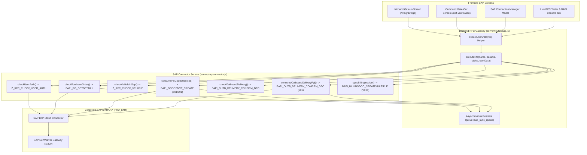

# Module 07: SAP S/4HANA Enterprise RFC & BAPI Connector
## Engineering & Enhancement Blueprint

---

### Document Information
- **Module ID:** `MOD-07-SAP-RFC`
- **Module Name:** SAP S/4HANA Enterprise RFC Gateway, BAPI Connector & Sync Queue
- **Primary Modal / Components:** 
  - [`src/components/sap/SapConnectionManagerModal.tsx`](file:///d:/Projects/AntiGravity/Aparna_RMC_App/rmc-gate-to-exit-main/src/components/sap/SapConnectionManagerModal.tsx)
  - [`server/sap-connector.js`](file:///d:/Projects/AntiGravity/Aparna_RMC_App/rmc-gate-to-exit-main/server/sap-connector.js)
  - [`server/routes/sap.js`](file:///d:/Projects/AntiGravity/Aparna_RMC_App/rmc-gate-to-exit-main/server/routes/sap.js)
- **Database Tables:** `sap_connection_config`, `sap_sync_queue`, `sap_purchase_orders`, `sap_outbound_deliveries`, `sap_weighbridge_sync`, `sap_exit_sync`, `sap_billing_sync`

---

## 1. Module Overview & Business Scope

The **SAP S/4HANA Enterprise Connector** is the central bi-directional bridge between the Aparna RMC plant floor operations and the corporate enterprise ERP system (**SAP S/4HANA Enterprise 2023, Client 100**).

Without real-time SAP integration, plant operators must manually re-key weighbridge slips into SAP GUI transactions `MIGO`, `VL02N`, and `VF01`. This causes inventory reconciliation delays, transcription errors, duplicate payments to cement suppliers, and billing delays to construction clients.

### Core Business Objectives:
1. **Multi-Protocol Enterprise Connectivity:** Supporting 3 connection modes:
   - `odata_cloud_connector`: Modern HTTPS OData v4 via SAP Business Technology Platform (BTP) Cloud Connector.
   - `rfc_netweaver`: Classic TCP RFC protocol over port $3300 + \text{sysnr}$.
   - `simulation`: High-fidelity offline development engine with realistic network jitter ($15-35\text{ ms}$).
2. **User Identity Audit Ingestion:** Enforcing operator attribution across every RFC payload (`Z_RFC_CHECK_USER_AUTH`, `BAPI_GOODSMVT_CREATE`, `BAPI_OUTB_DELIVERY_CONFIRM_DEC`).
3. **Resilient Asynchronous Sync Queue (`sap_sync_queue`):** Guaranteeing zero data loss if plant internet or corporate NetWeaver Gateway goes offline during a heavy pour shift.
4. **Interactive BAPI Console:** Integrated developer & administrator diagnostic console inside the UI to probe, execute, and inspect raw RFC function modules in real time.



---

## 2. Interactive BAPI Console & Modal Architecture

The [`SapConnectionManagerModal.tsx`](file:///d:/Projects/AntiGravity/Aparna_RMC_App/rmc-gate-to-exit-main/src/components/sap/SapConnectionManagerModal.tsx) component is structured into 4 tabs:

1. **System Status Tab:** High-level status badge (`ACTIVE_CONNECTED`), ping latency ($18\text{ ms}$), total MIGO syncs, total exit syncs, and pending queue count.
2. **Live Handshake Tab:** Real-time port probing testing TCP reachability, HTTP OPTIONS handshake, and CSRF token negotiation.
3. **Live RFC Tester & BAPI Console Tab:** Dedicated interactive testing panel allowing operators or SAP administrators to select from 5 function modules:
   - `BAPI_PO_GETDETAIL1`: Enter PO# (e.g. `4500128490`), inspect pending balances and tolerances.
   - `Z_RFC_CHECK_USER_AUTH`: Enter User ID, inspect authorization profiles and allowed movements.
   - `Z_RFC_CHECK_VEHICLE`: Enter plate (e.g. `TS07UA1289`), inspect auto-matched PO or OBD.
   - `BAPI_GOODSMVT_CREATE`: Enter PO#, vehicle plate, and net weight KG; executes simulated or live Goods Receipt.
   - `BAPI_OUTB_DELIVERY_CONFIRM_DEC`: Enter OBD#, vehicle plate, and net weight KG; executes Post Goods Issue.
4. **Config Tab:** Editable connection settings (System ID, Host, Port, Client, Username, Cloud Connector Location ID).

---

## 3. Function Module Contracts & Data Signatures

### 1. `Z_RFC_CHECK_USER_AUTH`
- **Import Parameters:** `USERNAME` (CHAR 12), `AUTH_CONTEXT` (STRUCTURE).
- **Export Parameters:** `AUTHORIZED` (BOOLEAN), `PROFILE` (CHAR 30), `ALLOWED_MOVEMENTS` (TABLE).
- **Backend Method:** `sapConnector.checkUserAuth(userData, authContext)`

### 2. `BAPI_PO_GETDETAIL1`
- **Import Parameters:** `PURCHASEORDER` (CHAR 10), `ITEMS` (CHAR 1).
- **Export Tables:** `POHEADER`, `POITEM`, `POSCHEDULE`.
- **Backend Method:** `sapConnector.checkPurchaseOrder(poNumber, userData)`

### 3. `Z_RFC_CHECK_VEHICLE`
- **Import Parameters:** `VEHICLE_REG_NO` (CHAR 20), `DIRECTION` (CHAR 10).
- **Export Parameters:** `MATCH_FOUND` (BOOLEAN), `MATCHED_PO` (STRUCTURE), `MATCHED_OBD` (STRUCTURE).
- **Backend Method:** `sapConnector.checkVehicleInSap(vehicleNo, userData, direction)`

### 4. `BAPI_GOODSMVT_CREATE`
- **Import Structure:** `GOODSMVT_HEADER` (`PSTNG_DATE`, `DOC_DATE`, `PR_UNAME`).
- **Import Code:** `GOODSMVT_CODE` (`01` for MIGO_GR).
- **Import Tables:** `GOODSMVT_ITEM` (`MATERIAL`, `PLANT`, `STGE_LOC`, `MOVE_TYPE: '101'`, `ENTRY_QNT`, `PO_NUMBER`, `PO_ITEM`).
- **Export Parameters:** `MATERIALDOCUMENT` (CHAR 10), `MATDOCUMENTYEAR` (CHAR 4).
- **Export Tables:** `RETURN` (`TYPE`, `ID`, `NUMBER`, `MESSAGE`).
- **Backend Method:** `sapConnector.consumePoGoodsReceipt(data, userData)`

### 5. `BAPI_OUTB_DELIVERY_CONFIRM_DEC`
- **Import Structure:** `HEADER_DATA` (`DELIV_NUMB`).
- **Import Tables:** `ITEM_DATA` (`DELIV_NUMB`, `DELIV_ITEM`, `ACT_DELIV_QTY`).
- **Backend Method:** `sapConnector.consumeOutboundDeliveryPgi(data, userData)`

---

## 4. Complete REST Gateway Endpoints (`server/routes/sap.js`)

| Method | Endpoint | Description |
| :--- | :--- | :--- |
| `GET` | `/api/sap/status` | Connection health, telemetry stats, and queue backlog count. |
| `GET` | `/api/sap/connection/config` | Returns active SAP connection configuration. |
| `POST` | `/api/sap/connection/config` | Updates connection parameters (Client, Host, Mode). |
| `POST` | `/api/sap/connection/test` | Live TCP handshake diagnostic. |
| `POST` | `/api/sap/rfc/check-user` | Verifies operator authorizations. |
| `POST` | `/api/sap/rfc/check-po` | Queries PO balances and line items via RFC. |
| `POST` | `/api/sap/rfc/check-vehicle` | Auto-matches scanned vehicle to open orders. |
| `POST` | `/api/sap/rfc/consume-po` | Posts MIGO Goods Receipt with operator audit. |
| `POST` | `/api/sap/rfc/check-delivery` | Verifies outbound delivery for PGI. |
| `POST` | `/api/sap/rfc/consume-delivery`| Posts Outbound PGI and clears exit barrier. |
| `POST` | `/api/sap/rfc/execute` | Generic BAPI function module dispatcher. |
| `GET` | `/api/sap/queue` | Returns pending / failed asynchronous sync items. |
| `POST` | `/api/sap/queue/retry/:id` | Manually triggers immediate retry of a queued failed sync. |

---

## 5. Database Schema & Data Dictionary

### Table: `sap_connection_config`
```sql
CREATE TABLE IF NOT EXISTS sap_connection_config (
  id VARCHAR(50) PRIMARY KEY,
  connection_type VARCHAR(50) NOT NULL DEFAULT 'odata_cloud_connector',
  system_id VARCHAR(50) DEFAULT 'PRD_S4H',
  system_name VARCHAR(100) DEFAULT 'SAP S/4HANA Enterprise 2023',
  host VARCHAR(200) DEFAULT 'sap-s4h.aparna-rmc.internal',
  port INT DEFAULT 44300,
  client VARCHAR(10) DEFAULT '100',
  sysnr VARCHAR(10) DEFAULT '00',
  username VARCHAR(100) DEFAULT 'RMC_GATE_SVC',
  password_masked VARCHAR(100) DEFAULT '••••••••••••',
  btp_destination_url VARCHAR(300),
  odata_base_url VARCHAR(300),
  use_cloud_connector TINYINT(1) DEFAULT 1,
  cloud_connector_location_id VARCHAR(100) DEFAULT 'HYD_RMC_PLANT_01',
  timeout_ms INT DEFAULT 12000,
  is_active TINYINT(1) DEFAULT 1,
  last_tested_at DATETIME,
  last_test_status VARCHAR(50) DEFAULT 'connected',
  last_test_latency_ms INT DEFAULT 18,
  created_at DATETIME DEFAULT CURRENT_TIMESTAMP,
  updated_at DATETIME DEFAULT CURRENT_TIMESTAMP ON UPDATE CURRENT_TIMESTAMP
) ENGINE=InnoDB DEFAULT CHARSET=utf8mb4;
```

### Table: `sap_sync_queue`
```sql
CREATE TABLE IF NOT EXISTS sap_sync_queue (
  id VARCHAR(50) PRIMARY KEY,
  sync_category VARCHAR(50) NOT NULL, -- 'GOODS_RECEIPT_MIGO' | 'GOODS_ISSUE_VL02N' | 'BILLING_VF01'
  reference_id VARCHAR(100),          -- PO# or Delivery#
  target_endpoint VARCHAR(200),
  status VARCHAR(30) DEFAULT 'queued', -- 'queued' | 'processing' | 'completed' | 'failed' | 'retry'
  retry_count INT DEFAULT 0,
  max_retries INT DEFAULT 5,
  last_attempt_at DATETIME,
  next_retry_at DATETIME,
  error_message TEXT,
  payload_json JSON,
  response_json JSON,
  created_at DATETIME DEFAULT CURRENT_TIMESTAMP,
  updated_at DATETIME DEFAULT CURRENT_TIMESTAMP ON UPDATE CURRENT_TIMESTAMP,
  INDEX idx_queue_status (status),
  INDEX idx_queue_cat (sync_category)
) ENGINE=InnoDB DEFAULT CHARSET=utf8mb4;
```

---

## 6. Business Logic & Error Recovery Mechanisms

### 1. Resilient Sync Queue Exponential Backoff
When an RFC call fails due to network timeout (`ETIMEDOUT`, `ECONNREFUSED`):
1. The transaction is immediately serialized and inserted into `sap_sync_queue`.
2. `retry_count` is incremented.
3. Next retry interval is calculated exponentially:
   $$\Delta t = 30 \times 2^{\text{retry\_count}} \text{ seconds} \quad (\text{Cap: } 1800\text{ s})$$
4. Operator is notified with a Sonner toast: `"SAP Offline: Transaction spooled in local resilient queue for automatic sync"`.

### 2. Idempotency Protection
Every sync request generates a unique `syncId`. If an operator double-clicks `[SAVE]`, the server queries `sap_weighbridge_sync` or `sap_exit_sync` before calling SAP to prevent duplicate Material Document postings.

---

## 7. Current Implementation vs Production Reality (Gaps)

| Feature | Current State | Production Reality Gap | Solution / Action Item |
| :--- | :--- | :--- | :--- |
| **Native SAP NetWeaver Binary** | Simulated responses using MySQL tables with realistic latency. | Requires real SAP NetWeaver SDK C++ libraries (`sapnwrfc.dll` on Windows / `libsapnwrfc.so` on Linux). | Deploy containerized SAP Cloud Connector (SCC) or microservice with SAP PyRFC / Node-RFC bindings. |
| **SAP SNC Encryption** | Standard credentials. | Production SAP requires Secure Network Communications (SNC) with X.509 PKI certificates. | Configure SNC partner name (e.g. `p:CN=PRD, OU=SAP, O=Aparna`) and PSE keystore. |
| **Automated Background Queue Worker** | Database table `sap_sync_queue` exists. | Background cron daemon needs continuous execution. | Deploy BullMQ or Node cron worker to process queued retries every 30 seconds. |

---

## 8. Future Enhancement Blueprint & Extension Hooks

1. **SAP Quality Management (QM) Inspection Lot Sync:**
   - Link 7-day and 28-day concrete cube compressive strength test results back to SAP QM inspection lots via `BAPI_INSPOPER_RECORDRESULTS`.
2. **Batch Plant Raw Material Auto-Backflush:**
   - Automatically execute Movement 261 (Goods Issue to Production Order) for every batch discharged by the Liebherr pan mixer.
3. **Automated Inter-Plant Stock Transport Order (STO):**
   - Automatically create STO outbound deliveries (Movement 641) when transferring bulk cement tankers to satellite plants.

---

## 9. Developer "How-To" Playbook: Step-by-Step Feature Extension

### Scenario: Adding a New BAPI Function Module (e.g. `BAPI_PRODORD_COMPLETE` for Batching Plant)

#### Step 1: Add Method in `server/sap-connector.js`
```javascript
async completeProductionOrder(orderNumber, actualYieldM3, userData) {
  // Query or post to SAP
  return {
    success: true,
    rfcName: 'BAPI_PRODORD_COMPLETE',
    orderNumber,
    actualYieldM3,
    status: 'TECO', // Technically Completed
    operatorId: userData.userId,
    timestamp: new Date().toISOString()
  };
}
```

#### Step 2: Add Case in `executeRfc` Dispatcher
In `server/sap-connector.js` -> `executeRfc`:
```javascript
case 'BAPI_PRODORD_COMPLETE':
  return this.completeProductionOrder(importParams.ORDER_NUMBER, importParams.YIELD, userData);
```

#### Step 3: Expose Route in `server/routes/sap.js`
```javascript
router.post('/rfc/complete-prod-order', async (req, res) => {
  const userData = extractUserData(req);
  const result = await sapConnector.completeProductionOrder(req.body.orderNumber, req.body.yieldM3, userData);
  res.json(result);
});
```

#### Step 4: Add Method in Frontend API Client (`src/lib/api.ts`)
```typescript
async completeSapProductionOrder(orderNumber: string, yieldM3: number, userData?: SapUserData) {
  return this.post('/sap/rfc/complete-prod-order', {
    orderNumber,
    yieldM3,
    userData: userData || this.getStoredUserData()
  });
}
```

#### Step 5: Test via Interactive BAPI Console
Add `BAPI_PRODORD_COMPLETE` to the function module selector in `SapConnectionManagerModal.tsx` and run an immediate test.

