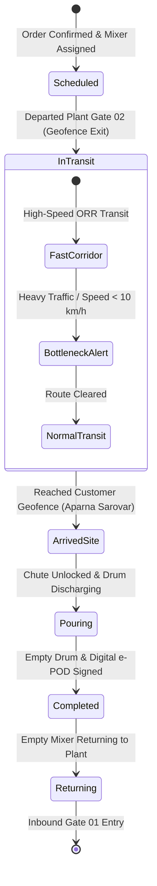

# Module 08: Trip Management & Real-Time GPS Tracking
## Engineering & Enhancement Blueprint

---

### Document Information
- **Module ID:** `MOD-08-TRIP-GPS`
- **Module Name:** Real-Time Trip Management, GPS Telemetry & Geofencing
- **Primary Routes:** `/trips`, `/trip-tracking`, `/trip-analytics`
- **Core Files:**
  - [`src/pages/TripManagement.tsx`](file:///d:/Projects/AntiGravity/Aparna_RMC_App/rmc-gate-to-exit-main/src/pages/TripManagement.tsx)
  - [`src/pages/TripTracking.tsx`](file:///d:/Projects/AntiGravity/Aparna_RMC_App/rmc-gate-to-exit-main/src/pages/TripTracking.tsx)
  - [`src/pages/TripAnalytics.tsx`](file:///d:/Projects/AntiGravity/Aparna_RMC_App/rmc-gate-to-exit-main/src/pages/TripAnalytics.tsx)
  - [`src/components/tripManagement/TripCard.tsx`](file:///d:/Projects/AntiGravity/Aparna_RMC_App/rmc-gate-to-exit-main/src/components/tripManagement/TripCard.tsx)
  - [`src/components/tripManagement/GeofenceManager.tsx`](file:///d:/Projects/AntiGravity/Aparna_RMC_App/rmc-gate-to-exit-main/src/components/tripManagement/GeofenceManager.tsx)
  - [`src/components/tripManagement/GPSDeviceManager.tsx`](file:///d:/Projects/AntiGravity/Aparna_RMC_App/rmc-gate-to-exit-main/src/components/tripManagement/GPSDeviceManager.tsx)
  - [`src/hooks/useTripManagement.ts`](file:///d:/Projects/AntiGravity/Aparna_RMC_App/rmc-gate-to-exit-main/src/hooks/useTripManagement.ts)
  - [`server/routes/trips.js`](file:///d:/Projects/AntiGravity/Aparna_RMC_App/rmc-gate-to-exit-main/server/routes/trips.js)
- **Database Tables:** `trips`, `trip_events`

---

## 1. Module Overview & Business Scope

The **Trip Management & GPS Tracking Module** monitors transit mixers once they clear the plant outbound boom barrier until concrete discharge is complete at the customer's pouring site.

In concrete logistics, time is the ultimate constraint:
$$\text{Concrete Fresh Window: } T_{\text{max}} = 90 \text{ minutes to } 120 \text{ minutes}$$
Beyond 120 minutes, initial hydration sets in, the concrete loses pumpability, and the entire drum load must be rejected at immense cost.

### Core Business Objectives:
1. **Satellite Real-Time GPS Tracking:** Ingesting latitude, longitude, speed ($km/h$), and heading from vehicle-mounted GPS trackers (Teltonika, Concox, or mobile app).
2. **Dynamic 90-Minute Hydration Countdown:** Flashing visual and audio warnings when remaining allowable travel time drops below 20 minutes.
3. **Automated Geofencing:** Circular or polygon geofences triggering automated arrival/departure milestones (`GEOFENCE_EXIT_PLANT`, `GEOFENCE_ENTER_CUSTOMER`).
4. **Drum Rotation Sensor Monitoring:** Monitoring whether the mixer drum is in transit agitation mode (2–4 rpm) or discharge mode (12–16 rpm reverse).



---

## 2. Component Architecture & UI Wireframe

### Component Hierarchy
```
src/pages/TripManagement.tsx
├── Summary Statistics (Active In-Transit, Arrived on Site, Completed Today, Delayed Alerts)
├── Tabs: [All Trips] | [In Transit] | [Delivered] | [Delayed]
├── TripCard.tsx (Vehicle Plate, Customer Site, Progress Bar, ETA Countdown)
├── TripDetailsDialog.tsx (Full telematics history, route path on map, speed telemetry)
├── GeofenceManager.tsx (Configure plant boundary & customer site radius)
└── GPSDeviceManager.tsx (IMEI number, SIM network, signal strength)
```

---

## 3. Backend Services & GPS Telematics Protocol

### Endpoints in `server/routes/trips.js`
- `GET /api/trips`: List active and historical trips with current GPS coordinates.
- `POST /api/trips`: Create new trip assignment.
- `PUT /api/trips/:id/status`: Update status (`in_transit`, `arrived`, `completed`, `cancelled`).
- `POST /api/trips/:id/gps-event`: Telematics webhook receiver accepting GPS coordinate packets.
- `GET /api/trips/:id/events`: Milestone log (`departed_plant`, `approaching_site`, `pour_started`).

---

## 4. API Contracts & Telemetry Specifications

### `POST /api/trips/:id/gps-event`
- **Request Body:**
```json
{
  "latitude": 17.485124,
  "longitude": 78.364912,
  "speedKmh": 42.5,
  "heading": 185.0,
  "altitudeMeters": 540,
  "drumStatus": "agitating_forward",
  "drumRpm": 3.2,
  "batteryVoltage": 13.8,
  "timestamp": "2026-10-28T22:30:00.000Z"
}
```
- **Response (200 OK):**
```json
{
  "success": true,
  "tripId": "trip_001",
  "distanceRemainingKm": 6.8,
  "etaMinutes": 18,
  "hydrationMinutesRemaining": 64,
  "geofenceStatus": "approaching_destination"
}
```

---

## 5. Database Schema & Data Dictionary

### Table: `trips`
```sql
CREATE TABLE IF NOT EXISTS trips (
  id VARCHAR(50) PRIMARY KEY,
  trip_number VARCHAR(50) UNIQUE NOT NULL,
  vehicle_id VARCHAR(50),
  vehicle_reg_no VARCHAR(50) NOT NULL,
  driver_id VARCHAR(50),
  driver_name VARCHAR(100),
  customer_id VARCHAR(50),
  customer_name VARCHAR(150),
  material VARCHAR(100),
  quantity DECIMAL(10,2),
  unit VARCHAR(20) DEFAULT 'm³',
  origin JSON,                          -- { name, lat, lng }
  destination JSON,                     -- { name, lat, lng, radius_meters }
  actual_start_time DATETIME,
  estimated_arrival DATETIME,
  actual_arrival DATETIME,
  completed_at DATETIME,
  status VARCHAR(30) DEFAULT 'scheduled', -- 'scheduled' | 'in_transit' | 'arrived' | 'completed' | 'cancelled'
  total_distance DECIMAL(10,2) DEFAULT 0,
  current_location JSON,                 -- { lat, lng, speed, heading, updated_at }
  gps_config JSON,                      -- { device_imei, sim_no }
  created_at DATETIME DEFAULT CURRENT_TIMESTAMP,
  updated_at DATETIME DEFAULT CURRENT_TIMESTAMP ON UPDATE CURRENT_TIMESTAMP,
  INDEX idx_trip_status (status),
  INDEX idx_trip_reg (vehicle_reg_no)
) ENGINE=InnoDB DEFAULT CHARSET=utf8mb4;
```

---

## 6. Business Logic & Concrete Setting Safeguards

1. **Hydration Warning Thresholds:**
   - Transit Time $< 60$ mins: Normal (Green status).
   - Transit Time $60 - 90$ mins: Warning (Amber status, driver alerted).
   - Transit Time $> 90$ mins: Critical Alert (Red status, SMS to Plant Head & Site Engineer to test slump prior to discharge).
2. **Reverse Drum Rotation on Road (Theft Detection):**
   - If drum rotation switches to reverse (discharge mode) while outside of designated site geofence, a critical `ILLEGAL_DISCHARGE_ALERT` incident is automatically dispatched.

---

## 7. Current Implementation vs Production Reality (Gaps)

| Feature | Current State | Production Reality Gap | Solution / Action Item |
| :--- | :--- | :--- | :--- |
| **Physical GPS Tracker Ingestion** | Simulated GPS coordinate updates. | Physical trucks use hardwired AIS-140 GPS trackers sending binary TCP packets. | Deploy TCP telematics listener listening on port 5027 parsing standard NMEA / GPRMC sentences. |
| **Drum Rotation Direction Sensor** | Virtual state flag. | Requires proximity sensor or hydraulic pressure sensor on mixer drum gearbox. | Wire Hall-effect inductive sensor to digital input of GPS tracker. |

---

## 8. Future Enhancement Blueprint & Extension Hooks

1. **Google Maps Traffic Integration:**
   - Real-time road congestion overlay calculating automatic rerouting recommendations.
2. **Automatic SMS / WhatsApp to Customer:**
   - Notify site engineer when transit mixer is 10 minutes away from pouring location.

---

## 9. Developer "How-To" Playbook: Step-by-Step Feature Extension

### Scenario: Adding Drum Agitation RPM to the Active Trips Monitor Table

#### Step 1: Update TypeScript Interface
In `src/types/tripManagement.ts`:
```typescript
export interface TripLocation {
  ...
  drumRpm?: number;
}
```

#### Step 2: Update Table Column in `ActiveTripsMonitor.tsx`
Add column:
```tsx
<TableCell className="font-mono text-emerald-400">
  {trip.current_location?.drumRpm || 0} RPM
</TableCell>
```

