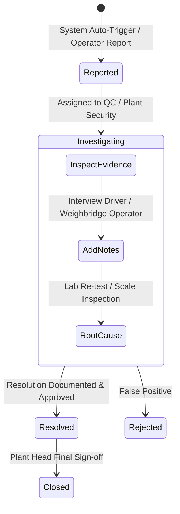

# Module 11: Incident Management & Operational Escalations
## Engineering & Enhancement Blueprint

---

### Document Information
- **Module ID:** `MOD-11-INCIDENTS`
- **Module Name:** Operational Incident Management, Anomaly Escalation & Audit Resolution
- **Primary Routes:** `/incidents`
- **Core Files:**
  - [`src/pages/IncidentManagement.tsx`](file:///d:/Projects/AntiGravity/Aparna_RMC_App/rmc-gate-to-exit-main/src/pages/IncidentManagement.tsx)
  - [`src/components/incident/IncidentCard.tsx`](file:///d:/Projects/AntiGravity/Aparna_RMC_App/rmc-gate-to-exit-main/src/components/incident/IncidentCard.tsx)
  - [`src/components/incident/CreateIncidentDialog.tsx`](file:///d:/Projects/AntiGravity/Aparna_RMC_App/rmc-gate-to-exit-main/src/components/incident/CreateIncidentDialog.tsx)
  - [`src/components/incident/IncidentDetailsDialog.tsx`](file:///d:/Projects/AntiGravity/Aparna_RMC_App/rmc-gate-to-exit-main/src/components/incident/IncidentDetailsDialog.tsx)
  - [`src/hooks/useIncidents.ts`](file:///d:/Projects/AntiGravity/Aparna_RMC_App/rmc-gate-to-exit-main/src/hooks/useIncidents.ts)
  - [`server/routes/incidents.js`](file:///d:/Projects/AntiGravity/Aparna_RMC_App/rmc-gate-to-exit-main/server/routes/incidents.js)
- **Database Tables:** `incidents`

---

## 1. Module Overview & Business Scope

The **Incident Management Module** is the plant-wide operational safety, audit, and quality exception handling desk. Any deviation from standard plant operating procedures automatically or manually creates an investigation ticket with photographic evidence and supervisor escalation.

### Common RMC Incident Categories:
1. **Weight & Tolerance Anomaly:** Outbound net concrete weight deviating $> \pm 1.5\%$ from expected batch schedule.
2. **Quality & Concrete Slump Failure:** Slump cone measurement falling outside pumpable specifications ($< 100\text{ mm}$ or $> 180\text{ mm}$).
3. **Security & Seal Tampering:** Chute cable seal broken, missing, or mismatched serial numbers at the exit gate or customer site.
4. **Logistics & Hydration Expiry:** Transit delay exceeding the critical 120-minute maximum allowable hydration window.
5. **Unauthorized Gate Clearance:** Barrier override without valid SAP Post Goods Issue (PGI) document.



---

## 2. Component Architecture & UI Wireframe

### Component Hierarchy
```
src/pages/IncidentManagement.tsx
├── useIncidents (src/hooks/useIncidents.ts)
├── Metrics Cards (Reported, Under Investigation, Resolved, Critical Severity)
├── Severity Tabs: [All] | [Reported] | [Investigating] | [Resolved]
├── Grid of Incident Cards:
│   └── IncidentCard.tsx
│       ├── Incident # (e.g. INC-2026-0042) & Severity Badge (Critical / High / Medium)
│       ├── Title & Description
│       ├── Vehicle Reg No & Related Module Tag (Weighbridge / Gate Exit / QC)
│       └── Reported Date & Assigned Investigator
│
├── CreateIncidentDialog.tsx (Manual incident entry with severity & photo attachments)
└── IncidentDetailsDialog.tsx (Timeline history, investigation notes, resolution sign-off)
```

---

## 3. Backend Services & Routing Architecture

### Endpoints in `server/routes/incidents.js`
- `GET /api/incidents`: List all incidents with filters by status, severity, and module.
- `POST /api/incidents`: Log new operational incident.
- `PUT /api/incidents/:id/status`: Update status (`investigating`, `resolved`, `closed`).
- `POST /api/incidents/:id/comments`: Add time-stamped investigator comments.
- `PUT /api/incidents/:id/resolve`: Resolve ticket with mandatory corrective action narrative.

---

## 4. API Contracts & Telemetry Specifications

### `POST /api/incidents`
- **Request Body:**
```json
{
  "title": "Outbound Exit Weight Tolerance Violation (+3.8%)",
  "description": "Transit Mixer TS07UA9944 weighed 17,440 KG net concrete vs 16,800 KG target (variance +640 KG / +3.81%). Exceeds maximum +/-1.5% limit.",
  "type": "weight_anomaly",
  "severity": "critical",
  "location": "Exit Weighbridge Scale Deck 02",
  "reportedBy": "Gowri K (Exit Operator)",
  "vehicleRegNo": "TS07UA9944",
  "relatedModule": "exit_verification",
  "tags": ["weight_variance", "sap_pgi_blocked", "over_batching"]
}
```
- **Response (200 OK):**
```json
{
  "success": true,
  "incidentId": "inc_0042",
  "incidentNumber": "INC-2026-0042",
  "status": "reported",
  "message": "Incident ticket created and escalated to Quality Head & Plant Manager."
}
```

---

## 5. Database Schema & Data Dictionary

### Table: `incidents`
```sql
CREATE TABLE IF NOT EXISTS incidents (
  id VARCHAR(50) PRIMARY KEY,
  incident_number VARCHAR(50) UNIQUE NOT NULL,
  title VARCHAR(200) NOT NULL,
  description TEXT NOT NULL,
  type VARCHAR(30) NOT NULL,            -- 'weight_anomaly' | 'quality_failure' | 'seal_tampering' | 'transit_delay' | 'safety'
  severity VARCHAR(30) NOT NULL,        -- 'critical' | 'high' | 'medium' | 'low'
  status VARCHAR(30) DEFAULT 'reported', -- 'reported' | 'investigating' | 'resolved' | 'closed'
  location VARCHAR(100),
  reported_by VARCHAR(100),
  reported_at DATETIME DEFAULT CURRENT_TIMESTAMP,
  assigned_to VARCHAR(100),
  investigation_notes TEXT,
  resolved_at DATETIME,
  resolution TEXT,
  vehicle_reg_no VARCHAR(50),
  related_module VARCHAR(50),
  tags JSON,
  evidence JSON,
  comments JSON,
  created_at DATETIME DEFAULT CURRENT_TIMESTAMP,
  updated_at DATETIME DEFAULT CURRENT_TIMESTAMP ON UPDATE CURRENT_TIMESTAMP,
  INDEX idx_inc_status (status),
  INDEX idx_inc_sev (severity)
) ENGINE=InnoDB DEFAULT CHARSET=utf8mb4;
```

---

## 6. Business Logic & Escalation Rules

1. **Auto-Ticket on Weight Anomaly:**
   In [`SapOutboundGateOutScreen.tsx`](file:///d:/Projects/AntiGravity/Aparna_RMC_App/rmc-gate-to-exit-main/src/components/exit/SapOutboundGateOutScreen.tsx), if $|\text{variancePct}| > 1.5\%$, an incident ticket is automatically spawned via `api.createIncident()` prior to prompting for supervisor override.
2. **Critical Severity Notification:**
   Critical severity tickets send high-priority push events to the Plant Head's dashboard with flashing visual alert banners.

---

## 7. Current Implementation vs Production Reality (Gaps)

| Feature | Current State | Production Reality Gap | Solution / Action Item |
| :--- | :--- | :--- | :--- |
| **Instant SMS / Email Escalation** | In-app dashboard notifications. | Supervisors off-site or on the plant yard floor do not see browser screens. | Integrate Twilio / AWS SNS / SendGrid to dispatch SMS to Plant Head mobile numbers. |
| **Corrective & Preventive Action (CAPA)** | Single text resolution field. | ISO 9001 quality audits require formal 8D / CAPA root cause analysis documents. | Add structured 5-Why root cause analysis template into the Incident Details dialog. |

---

## 8. Future Enhancement Blueprint & Extension Hooks

1. **AI Video Anomaly Detection:**
   - Computer vision model detecting unauthorized personnel climbing onto mixer drum ladder or tampering with chute discharge lever while on scale deck.
2. **SAP Quality Notification Sync:**
   - Automatically create an SAP QM Quality Notification (`Q1` / `Q2`) linked to the Purchase Order or Sales Order.

---

## 9. Developer "How-To" Playbook: Step-by-Step Feature Extension

### Scenario: Adding Root Cause Category Dropdown to Incident Resolution

#### Step 1: Database Migration
```sql
ALTER TABLE incidents ADD COLUMN root_cause_category VARCHAR(50) DEFAULT NULL AFTER resolution;
```

#### Step 2: UI Dialog Update
In `src/components/incident/IncidentDetailsDialog.tsx`, add a Select dropdown (`Operator Error`, `Batching Scale Drift`, `Admixture Overdose`, `Traffic Delay`, `Equipment Failure`).

