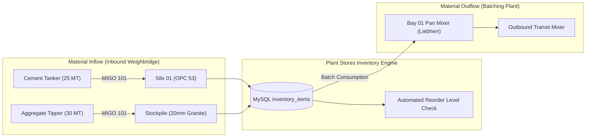

# Module 14: Raw Materials & Stores Inventory Management
## Engineering & Enhancement Blueprint

---

### Document Information
- **Module ID:** `MOD-14-INVENTORY`
- **Module Name:** Raw Material Stores, Silo Level Tracking & Stock Reconciliation
- **Primary Routes:** `/inventory`
- **Core Files:**
  - [`src/pages/InventoryManagement.tsx`](file:///d:/Projects/AntiGravity/Aparna_RMC_App/rmc-gate-to-exit-main/src/pages/InventoryManagement.tsx)
  - [`src/components/inventory/InventoryItemFormDialog.tsx`](file:///d:/Projects/AntiGravity/Aparna_RMC_App/rmc-gate-to-exit-main/src/components/inventory/InventoryItemFormDialog.tsx)
  - [`src/components/inventory/StockMovementDialog.tsx`](file:///d:/Projects/AntiGravity/Aparna_RMC_App/rmc-gate-to-exit-main/src/components/inventory/StockMovementDialog.tsx)
  - [`src/hooks/useInventoryManagement.ts`](file:///d:/Projects/AntiGravity/Aparna_RMC_App/rmc-gate-to-exit-main/src/hooks/useInventoryManagement.ts)
  - [`server/routes/inventory.js`](file:///d:/Projects/AntiGravity/Aparna_RMC_App/rmc-gate-to-exit-main/server/routes/inventory.js)
- **Database Tables:** `inventory_items`, `stock_movements`, `reorder_alerts`

---

## 1. Module Overview & Business Scope

The **Inventory & Raw Materials Module** provides visibility, material valuation, and real-time stock balancing for the essential ingredients used in Ready Mix Concrete manufacturing. 

An RMC plant cannot afford stockouts of cementitious materials or aggregates during continuous infrastructure pours (e.g., raft slab foundations requiring 500+ $m^3$ of uninterrupted concrete delivery).

### Core Raw Material Categories:
1. **Cementitious Silos:** OPC 53 Grade Cement, Portland Pozzolana Cement (PPC), Ground Granulated Blast-furnace Slag (GGBS), and Fly Ash stored in vertical pressurized steel silos (100–250 MT capacity each).
2. **Coarse Aggregates:** 20mm and 10mm crushed granite stored in outdoor partition bays.
3. **Fine Aggregates:** Manufactured Sand (M-Sand), Plaster Sand, and River Sand.
4. **Chemical Admixtures:** High-range water reducers (PCE superplasticizers), retarders, and air-entraining agents stored in calibrated plastic storage tanks.



---

## 2. Component Architecture & UI Wireframe

### Component Hierarchy
```
src/pages/InventoryManagement.tsx
├── useInventoryManagement (src/hooks/useInventoryManagement.ts)
├── Summary Metrics Cards (Total Inventory Value, Low Stock Alerts, Active SKUs)
├── Category Filter Tabs: [All] | [Cement] | [Aggregates] | [Sand] | [Admixtures]
├── Inventory Items Grid:
│   ├── Item Name, SKU, Location (SILO-01, BAY-AGG-01)
│   ├── Current Stock vs Max Capacity (Interactive visual fill bar)
│   ├── Reorder Level Warning Badge
│   └── Actions: [Record Movement], [Edit Item], [Delete]
│
├── InventoryItemFormDialog.tsx (Add/Edit item metadata, unit cost, safety stock)
└── StockMovementDialog.tsx (Manual adjustments, physical audit reconciliation)
```

---

## 3. Backend Services & Routing Architecture

### Endpoints in `server/routes/inventory.js`
- `GET /api/inventory/items`: List all raw material items with current stock and reorder status.
- `POST /api/inventory/items`: Create new inventory SKU profile.
- `PUT /api/inventory/items/:id`: Update item thresholds, unit costs, and storage location.
- `DELETE /api/inventory/items/:id`: Remove item profile.
- `GET /api/inventory/movements`: View historical ledger of stock inflows and outflows.
- `POST /api/inventory/movements`: Record manual adjustment or physical audit variance.
- `GET /api/inventory/alerts`: Returns active low-stock reorder warnings.

---

## 4. API Contracts & Telemetry Specifications

### `GET /api/inventory/items`
- **Response (200 OK):**
```json
[
  {
    "id": "inv_001",
    "name": "OPC 53 Grade Cement",
    "sku": "MAT-CEMENT-OPC53",
    "category": "cement",
    "unit": "ton",
    "currentStock": 142.50,
    "minStock": 30.00,
    "maxStock": 250.00,
    "reorderLevel": 50.00,
    "reorderQuantity": 80.00,
    "unitCost": 6200.00,
    "totalValue": 883500.00,
    "location": "SILO-01",
    "supplier": "Ultratech Cement Limited",
    "isLowStock": false
  }
]
```

---

## 5. Database Schema & Data Dictionary

### Table: `inventory_items`
```sql
CREATE TABLE IF NOT EXISTS inventory_items (
  id VARCHAR(50) PRIMARY KEY,
  name VARCHAR(150) NOT NULL,
  sku VARCHAR(100) UNIQUE NOT NULL,
  category VARCHAR(50) NOT NULL,       -- 'cement' | 'aggregate' | 'sand' | 'admixture'
  unit VARCHAR(30) NOT NULL,           -- 'ton' | 'kg' | 'litres'
  current_stock DECIMAL(12,2) DEFAULT 0,
  min_stock DECIMAL(12,2) DEFAULT 0,
  max_stock DECIMAL(12,2) DEFAULT 1000,
  reorder_level DECIMAL(12,2) DEFAULT 0,
  reorder_quantity DECIMAL(12,2) DEFAULT 0,
  unit_cost DECIMAL(12,2) DEFAULT 0,
  total_value DECIMAL(14,2) DEFAULT 0,
  location VARCHAR(100),               -- e.g. 'SILO-01', 'YARD-AGG-20MM'
  supplier VARCHAR(150),
  last_received DATE,
  last_consumed DATE,
  is_low_stock BOOLEAN DEFAULT FALSE,
  created_at DATETIME DEFAULT CURRENT_TIMESTAMP,
  updated_at DATETIME DEFAULT CURRENT_TIMESTAMP ON UPDATE CURRENT_TIMESTAMP,
  INDEX idx_inv_sku (sku),
  INDEX idx_inv_cat (category)
) ENGINE=InnoDB DEFAULT CHARSET=utf8mb4;
```

---

## 6. Business Logic & Stock Balancing Rules

1. **Inbound Automatic Increment:**
   Whenever an Inbound Weighbridge session completes a MIGO Goods Receipt, the backend automatically increments `inventory_items.current_stock` by the net scale weight in tons.
2. **Batch Loading Automatic Decrement:**
   Whenever a loading session is completed in `LoadingConsole`, the dispensed weights are deducted from the respective raw material SKUs.
3. **Reorder Alert Automation:**
   If `current_stock <= reorder_level`, `is_low_stock` is automatically set to `true`, and an alert is created in `reorder_alerts`.

---

## 7. Current Implementation vs Production Reality (Gaps)

| Feature | Current State | Production Reality Gap | Solution / Action Item |
| :--- | :--- | :--- | :--- |
| **Silo Level Sensors** | Stock calculated from math inflow/outflow. | Cement aeration, fluidization, and rat-holing inside silos can cause mathematical drift vs actual physical level. | Integrate ultrasonic / radar continuous level transmitters (e.g. Endress+Hauser) mounted on silo roofs. |
| **Stockpile Photogrammetry** | Yard manager estimates aggregate tons. | Outdoor aggregate piles shift due to loader digging and density changes with moisture. | Add drone photogrammetry or laser LiDAR volumetric stockpile scanning. |

---

## 8. Future Enhancement Blueprint & Extension Hooks

1. **Automated Purchase Requisition (PR) to SAP:**
   - Auto-generate an SAP PR (`BAPI_PR_CREATE`) when cement silo drops below 40 MT.
2. **Silo Aeration & Filter Backwash Diagnostics:**
   - Monitor dust collector differential pressure and fluidizing blower hours.

---

## 9. Developer "How-To" Playbook: Step-by-Step Feature Extension

### Scenario: Adding Silo Temperature Sensor Reading (°C) to Detect Hot Cement

#### Step 1: Database Migration
```sql
ALTER TABLE inventory_items ADD COLUMN silo_temp_c DECIMAL(4,1) DEFAULT NULL AFTER location;
```

#### Step 2: TypeScript Interface Update
In `src/types/inventory.ts`:
```typescript
export interface InventoryItem {
  ...
  siloTempC?: number;
}
```

#### Step 3: UI Card Update
In `src/pages/InventoryManagement.tsx`:
Add temperature gauge icon showing current silo temperature.

